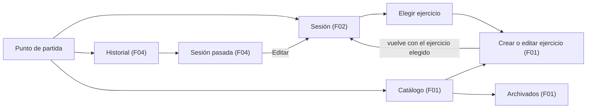

# Spec 40: Flujos de usuario

Oct 11, 2026 · @Juan

| ID | Estado | Fase | Depende de |
| --- | --- | --- | --- |
| 40 | Aprobada | 3 UX y UI | 01, 10 |

## Propósito

Esta spec define los flujos de usuario de la primera versión: qué hace el usuario, en qué orden, qué ve cuando algo sale bien o mal, qué se valida y cuándo, y cómo se conectan las features F00 a F04.

Define comportamiento, no apariencia. No decide el diseño visual (Spec 41) ni las pantallas, rutas y componentes concretos (Spec 42). Cuando un flujo dice "formulario" o "vista", la Spec 42 decide si es una pantalla, una hoja o un diálogo.

El dueño va a iterar mucho el diseño visual. Por eso esta spec evita reglas visuales, y los textos que propone son sugerencias que pueden cambiar. Los textos finales viven en `strings.xml` y los escribe cada spec F.

Cómo se aplica:

- Esta spec no tiene código propio. Las specs F implementan los flujos y presentan la evidencia de los criterios S40-A que les tocan (tabla "Reparto por feature").
- Las Specs 41 y 42 toman estos flujos como entrada para el diseño y las pantallas.
- Lo que un flujo necesita y no existe en las Specs 10 o 20 está en "Cambios que esta spec pide a otras specs". Ninguna regla ni consulta nueva se agrega en silencio.

El 2026-10-11 el dueño aceptó de antemano las recomendaciones y pidió escribir y aprobar esta spec en una sola pasada. Todas las decisiones quedan cerradas con la opción recomendada y conservan sus alternativas para poder revisarlas.

## Decisiones del dueño tomadas como dadas

| Tema | Decisión | Fuente |
| --- | --- | --- |
| Alcance | Solo F00 a F04. Nada de la visión a futuro | Spec 01, 2026-10-10 |
| Versiones | La 0.0.1 (MVP) trae F00 a F03. F04 llega en una 0.0.x posterior. La 0.1.0 trae F00 a F04 | Spec 01, 2026-10-11 |
| Sin conexión | Todo funciona sin red. Sin cuentas ni servidor | Constitución, S01-R05 |
| Peso | Solo kilogramos, precisión de 0,25 kg, de 0 a 1000 kg. En peso corporal es el peso adicional y vale 0 si no hay | S10-R01, S10-R02, S10-R15 |
| Repeticiones | Entero de 1 a 999 | S10-R03, S10-R15 |
| Notas | Dos tipos: la nota fija del ejercicio (F01) y la nota de la sesión (F02). No hay nota por serie | Spec 10 |
| Última vez | Todas las series del ejercicio en la sesión anterior más reciente que lo contiene, en orden. Desde una sesión abierta, solo cuentan las sesiones anteriores a ella. Desempate por `id` | S10-R25, S10-R26 |
| Archivar y eliminar | Eliminar un ejercicio con series lo archiva; uno sin series se borra. El nombre es único incluso entre archivados, y el dominio avisa si choca con un archivado | S10-R05, S10-R17 a S10-R21 |
| Fecha de la sesión | Solo el día, nunca futura, con "hoy" del reloj inyectado | S10-R13, S10-R32, ADR-30-09 |
| Varias sesiones por día | Permitidas, ordenadas por orden de creación | Spec 02, S10-R14 |
| Navegación | Navigation 3. El shell posee la pila. Las pantallas reciben la navegación como lambdas | ADR-30-10 |
| Efectos y escrituras | Los efectos de una sola vez son campos del `UiState`. Una escritura termina antes de navegar | ADR-30-07, ADR-30-08 |
| Última vez dentro de F02 | La vista de F02 tiene un hueco que el shell llena con la sección de F03 | D2 de la Spec 30 |
| Dispositivo | Solo teléfono | Spec 01 |
| Accesibilidad e idioma | Componentes Material 3 sin recortar su accesibilidad, áreas táctiles de al menos 48 dp, textos en español en `strings.xml` | Constitución |
| Control del peso | Esta spec describe la entrada del peso solo por intención. El dueño prefiere sliders de estilo Material 3 Expressive; el control lo eligen la Spec 42 y F02 | Dueño, 2026-10-11 |
| Diseño visual | El dueño va a iterar el diseño. Esta spec no fija reglas visuales y sus textos son sugerencias | Dueño, 2026-10-11 |
| Aprobación | El dueño aceptó de antemano las recomendaciones de esta spec | Dueño, 2026-10-11 |

## Quién y cuándo

### Usuario y contexto

Una sola persona, el dueño, que entrena en el gimnasio y usa su teléfono Android (Spec 01). No hay otros perfiles.

El uso típico ocurre entre series:

- De pie, con el teléfono en una mano y a veces con los dedos sudados o con guantes.
- En interacciones de segundos. El descanso dura de uno a tres minutos y la pantalla se apaga o la app pasa a segundo plano.
- Con interrupciones: música, mensajes, alguien que pide la máquina.
- A veces sin señal, por ejemplo en un sótano.

Registrar una serie rápido es el valor central. Todo lo demás (catálogo, historial, correcciones) se usa menos y puede tomar algún toque más.

### Trabajos por hacer

Este marco viene de la skill `user-research` (jobs to be done). No hubo investigación con usuarios: son supuestos del dueño, que se validan con su uso real en el gimnasio (S01-A04). Esta spec no planifica investigación.

| Cuando... | quiero... | para... | Feature |
| --- | --- | --- | --- |
| termino una serie | anotarla en segundos con una mano | volver a descansar sin perder el ritmo | F02 |
| llego a una máquina | ver con qué peso y repeticiones trabajé la última vez | decidir si subo o repito | F03 |
| ajusto una máquina | recordar cómo la configuro, por ejemplo "asiento en 4" | no perder tiempo probando | F01 (nota fija) |
| empiezo a usar la app | crear mis ejercicios durante la sesión | no tener que preparar nada antes | F01 desde F02 |
| me equivoco al anotar | corregir o borrar sin miedo | que mis datos sigan siendo confiables | F02, F04 |
| reviso mi semana | ver qué entrené cada día | planear la siguiente sesión | F04 |

## Principios de los flujos

1. **El camino rápido primero.** Registrar una serie de un ejercicio ya elegido no exige teclado cuando los valores propuestos sirven.
2. **Lo guardado está guardado.** Cada cambio se guarda con una acción explícita y queda en la base de datos al instante. No hay "guardar todo" ni borradores ocultos.
3. **La base de datos manda.** Lo que se ve sale de la base de datos (constitución, principio 3). La interfaz no simula estados que no existen.
4. **Lo irreversible se confirma, lo reversible se deshace.** Ver D7.
5. **Nada solo por gesto.** Todo se hace con un toque sobre un control visible.
6. **Comportamiento, no apariencia.** Esta spec no fija colores, tamaños, posiciones ni animaciones.

## Mapa de los flujos

### Áreas y cómo se conectan

La sección de la última vez (F03) vive dentro de la sesión, en el hueco de D2 de la Spec 30.

### Navegación entre flujos, por intención

- Desde el punto de partida, el usuario empieza o continúa la sesión de hoy en un toque, y llega al historial o al catálogo en un toque.
- Desde la sesión, el usuario elige un ejercicio. Si no existe, lo crea y vuelve a la sesión con ese ejercicio elegido, listo para su primera serie.
- Desde la sesión, el usuario ve la nota fija del ejercicio que está registrando y puede ir a editar ese ejercicio y volver.
- Desde el historial, el usuario abre una sesión pasada en modo de solo lectura. Desde ahí la edita con el mismo flujo de la sesión de F02, o la elimina.
- Desde el catálogo, el usuario crea y edita ejercicios, y abre los archivados para desarchivarlos.
- Atrás siempre vuelve al paso anterior. Desde un área principal vuelve al punto de partida, y desde el punto de partida sale de la app.

La Spec 42 decide las pantallas, las rutas, si hay una pila o varias, y cómo se pasa un resultado entre vistas.

### Reparto por feature

| Feature | Flujos que implementa |
| --- | --- |
| F00 | S40-F01 y S40-F02 (estructura, navegación entre áreas, atrás y salida) |
| F01 | S40-F03 a S40-F07, el editor de S40-F11 y su parte de S40-F21 |
| F02 | S40-F08 a S40-F15, S40-F23, su parte de S40-F21 y el destino de S40-F19 |
| F03 | S40-F16 |
| F04 | S40-F17, S40-F18, S40-F20 y la entrada de S40-F19 |
| F01 a F04 | S40-F22, el recorrido de S01-A04 |

Por versiones (Spec 01): la 0.0.1 trae los flujos de F00 a F03. Mientras F04 no exista, el punto de partida no ofrece el historial y F00 decide qué muestra en su lugar. En la 0.0.1, una sesión de otro día o una sesión vacía no se puede abrir ni eliminar; eso llega con F04. El criterio de la 0.0.1 es el recorrido S40-F22 sin el paso 6.

## Flujos

Cada flujo indica su entrada, sus pasos, el resultado esperado, los caminos alternativos y de error, el estado vacío cuando aplica y lo que valida. La tabla "Validaciones y cuándo se comprueban" liga cada validación a su regla de la Spec 10.

### Punto de partida (F00)

**S40-F01. Abrir la app**

- **Entrada.** El usuario abre la app desde el lanzador.
- **Pasos.** La app muestra el punto de partida (D1).
- **Éxito.** Sin desplazarse, el usuario ve la acción principal: "Empezar sesión" si no hay una sesión con fecha de hoy, o "Continuar sesión" si la hay. Además llega al historial y al catálogo en un toque.
- **Alternativas.** Si ya hay una sesión de hoy, se ofrece también, como acción secundaria, empezar otra sesión el mismo día (S40-F09).
- **Vacío.** En el primer uso no hay sesiones ni ejercicios. El punto de partida ofrece "Empezar sesión" igual: el flujo de la sesión lleva a crear el primer ejercicio (S40-F22). No hay tutorial.
- **Valida.** Nada. "Hoy" sale del reloj del `AppContainer` (ADR-30-09). Saber si hay una sesión de hoy se deriva del historial (S10-R28): es su primer elemento si tiene la fecha de hoy. No hace falta una consulta nueva.

**S40-F02. Moverse entre áreas, volver y salir**

- **Entrada.** El usuario está en cualquier punto de la app.
- **Pasos.** Usa la navegación de la app o el gesto o botón atrás del sistema.
- **Éxito.** Atrás vuelve al paso anterior. Desde la raíz de un área principal distinta del punto de partida, atrás vuelve al punto de partida. Desde el punto de partida, atrás sale de la app.
- **Alternativas.** Si la app pasa a segundo plano, al volver el usuario sigue donde estaba. Si el sistema cerró el proceso, la app vuelve a la misma ubicación con todo lo guardado; solo se pierde lo no guardado de un formulario abierto (D19).
- **Valida.** Nada. Los formularios con cambios sin guardar siguen S40-F21.

### Catálogo (F01)

**S40-F03. Ver y buscar en el catálogo**

- **Entrada.** El usuario abre el catálogo desde el punto de partida.
- **Pasos.** Ve los ejercicios no archivados ordenados por nombre (S10-R30). Puede buscar por nombre y filtrar por músculo y por equipo (D10). Toca un ejercicio para editarlo (S40-F05) o crea uno nuevo (S40-F04).
- **Éxito.** Encuentra el ejercicio en pocos toques, también con un catálogo largo.
- **Alternativas.** Desde aquí abre los archivados (S40-F07). Si la búsqueda no encuentra nada, se ofrece crear un ejercicio con el texto buscado como nombre.
- **Vacío.** Catálogo vacío: explica que los ejercicios se crean aquí y ofrece "Crear ejercicio". Búsqueda sin resultados: lo dice y ofrece crear o limpiar la búsqueda.
- **Valida.** Nada. La búsqueda necesita una regla nueva en la Spec 10 (ver "Cambios").

**S40-F04. Crear un ejercicio**

- **Entrada.** "Crear ejercicio" desde el catálogo, desde una búsqueda sin resultados o desde la sesión (S40-F11).
- **Pasos.**
  1. Escribe el nombre. Si vino de una búsqueda, el nombre ya trae el texto buscado.
  2. Elige el equipo: máquina, polea, mancuerna, barra o peso corporal.
  3. Elige uno o más músculos y marca cuáles son principales. El primer músculo elegido queda como principal hasta que el usuario lo cambie.
  4. Si quiere, escribe la nota fija, por ejemplo "Asiento en la posición 4".
  5. Toca "Guardar ejercicio".
- **Éxito.** El ejercicio queda guardado y la app vuelve al origen: al catálogo, con el ejercicio en la lista, o a la sesión, con el ejercicio elegido. No se muestra aviso: el ejercicio se ve.
- **Alternativas y errores.**
  - Un rechazo del dominio se muestra junto a su campo, y el formulario conserva lo escrito (D18).
  - El nombre ya lo usa un ejercicio activo: error junto al nombre.
  - El nombre ya lo usa un ejercicio archivado: la app ofrece elegir entre desarchivar ese ejercicio o usar otro nombre (D9). Si elige desarchivar, recupera el archivado tal como estaba, con su historial, y descarta el formulario. Luego vuelve al origen como si lo hubiera creado.
  - Atrás con cambios sin guardar sigue S40-F21.
- **Valida.** S10-R04 a S10-R08, S10-R12, S10-R15 y S10-R21, al tocar "Guardar ejercicio". Repetir un músculo no es posible por cómo funciona el formulario (S10-R08).

**S40-F05. Editar un ejercicio**

- **Entrada.** El usuario toca un ejercicio del catálogo, o elige "Editar ejercicio" desde la sesión (S40-F12).
- **Pasos.** Cambia nombre, equipo, músculos o nota y toca "Guardar ejercicio".
- **Éxito.** Los cambios quedan guardados y la app vuelve al origen. El ejercicio conserva su `id` y todas sus series (S10-R22): el nuevo nombre aparece en la sesión, en la última vez y en el historial.
- **Alternativas y errores.** Iguales a S40-F04, con una diferencia: si el nuevo nombre lo usa un ejercicio archivado, el error se muestra junto al nombre y no se ofrece desarchivar, porque desarchivar el otro no resuelve el cambio de nombre. Desde aquí también se archiva o se elimina (S40-F06).
- **Valida.** Las mismas reglas de S40-F04. Un ejercicio editado conserva su estado de archivado.

**S40-F06. Archivar o eliminar un ejercicio**

- **Entrada.** Desde la edición de un ejercicio (S40-F05).
- **Pasos.** La edición muestra una sola acción, según el ejercicio tenga series o no (D8):
  - **Con series:** "Archivar ejercicio". Se archiva al momento, sin diálogo, y la app vuelve al origen con un aviso que ofrece "Deshacer". Deshacer lo desarchiva.
  - **Sin series:** "Eliminar ejercicio". Un diálogo pide confirmar y aclara que no se puede deshacer. Al confirmar, se borra con sus músculos y la app vuelve al origen con un aviso.
- **Éxito.** El ejercicio sale del catálogo y del selector de la sesión (S10-R18). Si se archivó, sus series siguen en el historial y en la última vez.
- **Alternativas.** La decisión final la toma el dominio dentro de una transacción (S20-R40). Si entre que se mostró la acción y se confirmó el ejercicio ganó series, se archiva en lugar de borrarse, y el aviso dice lo que pasó y ofrece "Deshacer". Si el ejercicio ya no existe, se trata como un fallo inesperado (S30-R23). Cancelar el diálogo no cambia nada.
- **Valida.** S10-R17 y S10-R20. Saber si un ejercicio tiene series necesita una lectura nueva en `ExerciseRepository` (ver "Cambios").

**S40-F07. Ver archivados y desarchivar**

- **Entrada.** "Archivados" desde el catálogo.
- **Pasos.** Ve los ejercicios archivados ordenados por nombre (S10-R31) y toca "Desarchivar" en uno.
- **Éxito.** El ejercicio vuelve al catálogo con todo su historial (S10-R19). Sale de la lista de archivados y un aviso lo confirma.
- **Vacío.** Lo explica: aquí aparecen los ejercicios que se archivan.
- **Valida.** Nada. Desarchivar no tiene reglas que puedan fallar.

### Sesión (F02)

**S40-F08. Empezar o continuar la sesión de hoy**

- **Entrada.** "Empezar sesión" o "Continuar sesión" en el punto de partida.
- **Pasos.**
  - **Empezar:** la app crea una sesión con la fecha de hoy y la abre (D3). La crea antes de navegar (S30-R35).
  - **Continuar:** la app abre la sesión más reciente con fecha de hoy. Si hay dos del mismo día, abre la de mayor `id` (S10-R28).
- **Éxito.** El usuario ve la sesión con su fecha, sus series agrupadas por ejercicio (D16) y la acción "Agregar ejercicio".
- **Alternativas.** Una sesión empezada antes de la medianoche conserva su fecha. Después de la medianoche, el punto de partida ya no la ofrece para continuar; el usuario la abre desde el historial (S40-F19). Un doble toque en "Empezar sesión" crea una sola sesión.
- **Vacío.** Sesión sin series: explica que todavía no tiene series y ofrece "Agregar ejercicio".
- **Valida.** S10-R13 y S10-R32: la fecha sale del reloj y nunca es futura.

**S40-F09. Empezar otra sesión el mismo día**

- **Entrada.** La acción secundaria del punto de partida cuando ya hay una sesión de hoy (D2).
- **Pasos.** La app crea una sesión nueva con la fecha de hoy y la abre.
- **Éxito.** La nueva sesión es la más reciente de hoy: la siguiente vez, "Continuar sesión" abre esta.
- **Valida.** Las mismas reglas de S40-F08.

**S40-F10. Elegir un ejercicio en la sesión**

- **Entrada.** "Agregar ejercicio" en la sesión.
- **Pasos.** El usuario ve el catálogo activo, sin archivados (S10-R18), con la misma búsqueda y los mismos filtros del catálogo (D10). Toca un ejercicio.
- **Éxito.** Se abre el formulario de serie de ese ejercicio (S40-F12), con la última vez visible (S40-F16).
- **Alternativas.** Elegir un ejercicio que ya está en la sesión abre su formulario de serie y no lo duplica. Elegir un ejercicio no escribe nada: un ejercicio aparece en la sesión solo cuando tiene al menos una serie guardada, porque no existe una entidad de "ejercicio dentro de la sesión" (Spec 10). Si la búsqueda no encuentra nada, se ofrece crear el ejercicio con ese nombre (S40-F11).
- **Vacío.** Catálogo vacío: explica que primero hay que crear un ejercicio y ofrece "Crear ejercicio".
- **Valida.** Nada.

**S40-F11. Crear un ejercicio desde la sesión**

- **Entrada.** "Crear ejercicio" desde la elección de ejercicio (S40-F10).
- **Pasos.** El usuario sigue S40-F04.
- **Éxito.** Al guardar, la app vuelve a la sesión con el nuevo ejercicio elegido y su formulario de serie abierto. Lo mismo pasa si en lugar de crear elige desarchivar un ejercicio con ese nombre (D9).
- **Alternativas.** Si cancela, vuelve a la elección de ejercicio sin cambios. Si el sistema cerró el proceso mientras tanto, el ejercicio guardado sigue en el catálogo, pero el usuario puede volver a la sesión sin la selección y tener que elegirlo.
- **Valida.** Las reglas de S40-F04.

**S40-F12. Registrar una serie**

- **Entrada.** El formulario de serie de un ejercicio, abierto desde S40-F10, S40-F11 o "Agregar serie" en el grupo del ejercicio en la sesión.
- **Pasos.**
  1. El usuario ve el ejercicio, su nota fija si tiene (D13) y la última vez (S40-F16).
  2. Ajusta el peso y las repeticiones. Parte de valores propuestos (D5): la primera serie del ejercicio en esta sesión propone la primera serie de la última vez; las siguientes proponen la serie anterior de hoy. El peso va de 0,25 en 0,25 kg, de 0 a 1000 kg. En peso corporal el campo es el peso adicional y parte de 0.
  3. Toca "Guardar serie".
- **Éxito.** La serie queda guardada y aparece en la sesión con su número dentro del ejercicio. El formulario queda listo para la siguiente serie con los mismos valores, de modo que repetir una serie igual es un toque. TalkBack anuncia la serie guardada.
- **Alternativas y errores.**
  - Sin última vez ni serie previa hoy no hay valores propuestos. El usuario fija el peso y las repeticiones antes de poder guardar, salvo el peso adicional en peso corporal, que parte de 0. La app nunca guarda un valor que el usuario no fijó ni aceptó.
  - Un valor fuera de las reglas se rechaza junto a su campo y no se guarda nada. La app no redondea en silencio un valor que fijó el usuario.
  - Mientras se guarda, "Guardar serie" no se puede volver a tocar.
  - Desde aquí el usuario puede ir a "Editar ejercicio" (S40-F05) y volver al mismo formulario.
  - Cerrar el formulario vuelve a la sesión. Con cambios sin guardar sigue S40-F21.
- **Valida.** S10-R01, S10-R02, S10-R03, S10-R11 y S10-R15, al tocar "Guardar serie", con el caso de uso de F02 (S30-R20). El `order` lo asigna el dominio (S10-R09) y no se ve.

La Spec 42, con F02, elige el control para el peso y las repeticiones. El dueño prefiere sliders de estilo Material 3 Expressive. Precisión de 0,25 kg en un rango de 0 a 1000 kg exige una forma de ajuste fino (ver "Cambios").

**S40-F13. Corregir o eliminar una serie**

- **Entrada.** El usuario toca una serie de la sesión.
- **Pasos.**
  - **Corregir:** se abre el formulario de serie con sus valores y la última vez. El usuario ajusta el peso o las repeticiones y toca "Guardar cambios".
  - **Eliminar:** "Eliminar serie" abre un diálogo que muestra la serie y dice que no se puede deshacer. El usuario confirma con "Eliminar serie".
- **Éxito.** Al corregir, la serie muestra los nuevos valores en su mismo lugar. Al eliminar, desaparece y las demás se renumeran en pantalla; sus valores de `order` no cambian (S10-R09).
- **Alternativas.** Cancelar el diálogo no cambia nada. Si la sesión queda sin series, sigue existiendo (S10-R24) y muestra su estado vacío. Las series de un ejercicio archivado se pueden corregir y eliminar (S10-R11). El ejercicio de una serie no se cambia en la primera versión: se elimina la serie y se registra de nuevo (D15).
- **Valida.** S10-R01 a S10-R03 y S10-R15 al guardar la corrección, con el caso de uso de F02 (S30-R20). Eliminar no tiene reglas (S10-R24).

**S40-F14. Cambiar la fecha o la nota de la sesión**

- **Entrada.** "Editar sesión" en la sesión.
- **Pasos.** Cambia la fecha, la nota o ambas, y toca "Guardar".
- **Éxito.** La sesión muestra la nueva fecha y la nueva nota. Si cambió la fecha, la sesión cambia de lugar en el historial y puede cambiar la última vez de otras sesiones (S10-R26).
- **Alternativas.** Los días futuros no se pueden elegir. Si aun así llega una fecha futura, se rechaza. Una nota solo con espacios se guarda vacía (S10-R12). Con cambios sin guardar sigue S40-F21.
- **Valida.** S10-R12, S10-R13, S10-R15 y S10-R32, al tocar "Guardar", con el caso de uso de F02 (S30-R20).

Cambiar la fecha sirve también para anotar una sesión olvidada: el usuario empieza una sesión, le pone la fecha del día real y registra sus series (D17).

**S40-F15. Salir de la sesión**

- **Entrada.** Atrás, o la navegación de la app, desde la sesión.
- **Pasos.** No hay un paso de terminar (D4).
- **Éxito.** La app vuelve a donde se abrió la sesión. Todas las series ya estaban guardadas. Al volver, la sesión muestra todo lo registrado.
- **Valida.** Nada.

### Última vez (F03)

**S40-F16. Ver la última vez al registrar**

- **Entrada.** El usuario abre el formulario de serie de un ejercicio, para una serie nueva o para corregir una.
- **Pasos.** Ninguno: la última vez se ve sin toques extra (D6).
- **Éxito.** Ve la fecha de la sesión anterior que contiene el ejercicio y todas sus series de ese día, en el orden en que se registraron (S10-R25). Por ejemplo: "jue 8 oct · 60 kg × 10, 60 kg × 10, 60 kg × 8".
- **Alternativas.** La última vez es relativa a la sesión abierta (S10-R26). Al registrar hoy, excluye las series de hoy. Al corregir una sesión antigua, muestra la sesión anterior a esa. Con dos sesiones el mismo día, la más reciente es la de mayor `id`. Incluye las series de un ejercicio archivado (S10-R18).
- **Vacío.** Sin series anteriores: dice que es la primera vez con este ejercicio.
- **Valida.** Nada. Solo lee.

F02 usa la misma consulta (S20-R29) para proponer los valores de S40-F12. La sección visible es de F03, en el hueco de D2 de la Spec 30.

### Historial (F04)

**S40-F17. Ver el historial**

- **Entrada.** El historial desde el punto de partida.
- **Pasos.** El usuario ve sus sesiones de la más reciente a la más antigua (S10-R28). Cada sesión se reconoce por su fecha, sus ejercicios y su número de series (D14). Toca una para abrirla.
- **Alternativas.** Una sesión sin series se marca como tal, para que el usuario la reconozca y pueda eliminarla.
- **Vacío.** Explica que aquí aparecen las sesiones y ofrece "Empezar sesión".
- **Valida.** Nada. El resumen por sesión necesita una consulta nueva (ver "Cambios").

**S40-F18. Ver una sesión pasada**

- **Entrada.** El usuario toca una sesión del historial.
- **Pasos.** Ve la sesión en modo de solo lectura (D11): fecha, nota y series agrupadas por ejercicio, incluidas las de ejercicios archivados, marcados como tales (S10-R29).
- **Éxito.** Revisa lo que hizo sin riesgo de cambiar nada por accidente.
- **Alternativas.** Desde aquí elige "Editar" (S40-F19) o "Eliminar sesión" (S40-F20).
- **Valida.** Nada.

**S40-F19. Corregir una sesión pasada**

- **Entrada.** "Editar" en una sesión pasada.
- **Pasos.** Se abre el flujo de la sesión de F02 sobre esa sesión, con su fecha bien visible. El usuario usa S40-F10 a S40-F14 con las mismas reglas.
- **Éxito.** Al volver, la vista de solo lectura muestra los cambios.
- **Alternativas.** La última vez se calcula respecto a esa sesión (S10-R26). Las series de un ejercicio archivado se corrigen o eliminan, pero no se agregan (S10-R11).
- **Valida.** Las reglas de S40-F12 a S40-F14.

**S40-F20. Eliminar una sesión**

- **Entrada.** "Eliminar sesión" en una sesión pasada.
- **Pasos.** Un diálogo nombra la sesión por su fecha, dice cuántas series se eliminan y que no se puede deshacer. El usuario confirma con "Eliminar sesión".
- **Éxito.** La sesión y todas sus series se eliminan (S10-R23). La app vuelve al historial con un aviso.
- **Alternativas.** Cancelar no cambia nada. Los ejercicios no cambian aunque queden sin series.
- **Valida.** Nada que pueda fallar. La escritura termina antes de navegar (S30-R35).

### Comunes

**S40-F21. Salir de un formulario con cambios sin guardar**

- **Entrada.** Atrás, o cerrar, en un formulario de guardado explícito: crear o editar ejercicio, formulario de serie y datos de la sesión.
- **Pasos.**
  - Sin cambios respecto a los valores iniciales, el formulario se cierra sin preguntar. Los valores propuestos cuentan como iniciales.
  - Con cambios, un diálogo pregunta si descartarlos, con "Descartar" y "Seguir editando" (D12).
- **Éxito.** "Descartar" cierra sin escribir nada. "Seguir editando" o atrás sobre el diálogo vuelven al formulario con todo lo escrito.
- **Valida.** Nada.

### Recorridos completos

**S40-F22. Primer uso (S01-A04)**

Con la app recién instalada y en modo avión:

1. Abre la app (S40-F01) y toca "Empezar sesión" (S40-F08).
2. Toca "Agregar ejercicio". El catálogo está vacío y ofrece "Crear ejercicio" (S40-F10).
3. Crea "Press de banca": barra, pecho como principal y tríceps como secundario (S40-F11).
4. Vuelve a la sesión con el ejercicio elegido. La última vez dice que es la primera vez (S40-F16).
5. Fija 60 kg × 10 y guarda. Guarda otra serie con los valores propuestos (S40-F12).
6. Sale de la sesión (S40-F15) y la abre desde el historial (S40-F17, S40-F18).
7. Al día siguiente, al registrar "Press de banca", la última vez muestra las dos series.

**S40-F23. Sesión típica**

Con "Press de banca" en el catálogo y su última vez "60 kg × 10, 60 kg × 10, 60 kg × 8":

1. "Continuar sesión" o "Empezar sesión" (1 toque).
2. "Agregar ejercicio" (2) y elige "Press de banca" (3). El formulario propone 60 kg × 10.
3. "Guardar serie" (4). Primera serie registrada, sin teclado.
4. Descansa. "Guardar serie" de nuevo: 60 kg × 10 (1 toque).
5. Ajusta las repeticiones a 8 y guarda.
6. Cierra el formulario y sigue con el siguiente ejercicio.

## Validaciones y cuándo se comprueban

Regla general: se valida al tocar la acción de guardar. Después de un intento fallido, el error se actualiza mientras el usuario corrige y desaparece cuando el valor es válido. Lo que el formulario puede impedir por construcción no llega a ser un error.

| Regla | Qué se valida | Flujos | Cuándo | Cómo se ve |
| --- | --- | --- | --- | --- |
| S10-R04 | Nombre vacío tras quitar espacios | S40-F04, S40-F05 | Al guardar | Junto al nombre. El nombre se guarda normalizado |
| S10-R15 | Nombre de más de 60 caracteres | S40-F04, S40-F05 | Al guardar | Junto al nombre |
| S10-R05 | Nombre de un ejercicio activo | S40-F04, S40-F05 | Al guardar | Junto al nombre |
| S10-R05, S10-R21 | Nombre de un ejercicio archivado | S40-F04, S40-F11 | Al guardar | Elección: desarchivar o usar otro nombre (D9) |
| S10-R05 | Nombre de un archivado, al editar | S40-F05 | Al guardar | Junto al nombre, sin oferta de desarchivar |
| S10-R06 | Falta el equipo | S40-F04, S40-F05 | Al guardar | Junto al equipo |
| S10-R06 | Faltan músculos | S40-F04, S40-F05 | Al guardar | Junto a los músculos |
| S10-R07 | Ningún músculo principal | S40-F04, S40-F05 | Al guardar | Junto a los músculos. El primer músculo elegido es principal por defecto |
| S10-R08 | Músculo repetido | S40-F04, S40-F05 | Impedido | El formulario no permite elegir un músculo dos veces |
| S10-R12 | Nota con espacios en los extremos o vacía | S40-F04, S40-F05, S40-F14 | Al guardar | Sin error. Se guarda limpia o vacía |
| S10-R15 | Nota de más de 500 caracteres | S40-F04, S40-F05, S40-F14 | Al guardar | Junto a la nota |
| S10-R01 | Peso negativo o no múltiplo de 0,25 kg | S40-F12, S40-F13 | Impedido cuando el control lo permite; si no, al guardar | Junto al peso |
| S10-R15 | Peso mayor que 1000 kg | S40-F12, S40-F13 | Igual que la anterior | Junto al peso |
| S10-R02 | Peso corporal: peso adicional, 0 sin peso | S40-F12, S40-F13 | Siempre | El campo se presenta como peso adicional |
| S10-R03, S10-R15 | Repeticiones de 1 a 999 | S40-F12, S40-F13 | Impedido cuando el control lo permite; si no, al guardar | Junto a las repeticiones |
| Interfaz | Peso o repeticiones sin fijar cuando no hay valor propuesto | S40-F12 | Al guardar | Junto al campo. Es una regla de la interfaz, no del dominio |
| S10-R11 | Agregar una serie a un ejercicio archivado | S40-F12, S40-F19 | Impedido | No se ofrece "Agregar serie". Si llega, se rechaza al guardar |
| S10-R09 | Orden de la serie | S40-F12 | Automático | No se ve. La numeración visible es la posición |
| S10-R13 | Fecha obligatoria | S40-F08, S40-F14 | Siempre | Siempre tiene valor: hoy al empezar |
| S10-R32 | Fecha futura | S40-F08, S40-F14 | Impedido al elegir y además al guardar | Junto a la fecha |
| S10-R17, S10-R20 | Archivar o borrar | S40-F06 | En la transacción del repositorio (S20-R40) | El aviso dice lo que pasó |
| S10-R23 | Eliminar sesión con sus series | S40-F20 | Al confirmar | Aviso en el historial |
| S10-R24 | Eliminar serie | S40-F13 | Al confirmar | La serie desaparece |

## Atrás y cambios sin guardar

Resumen del comportamiento. La implementación la decide la Spec 42.

- **Atrás normal.** Lo maneja `NavDisplay` de Navigation 3, con el atrás predictivo del sistema (ADR-30-10). La skill `navigation-event` pide usar el manejo de Navigation 3 cuando está presente.
- **Formularios con cambios.** Solo un formulario con cambios sin guardar intercepta atrás. Por la skill `navigation-event`, cada pantalla tiene un solo `NavigationBackHandler`, activo solo cuando hay cambios. Sin cambios, el manejador queda inactivo y atrás conserva su animación predictiva. Si hay cambios lo dice el `UiState` (Spec 30, "Costuras").
- **Diálogos.** Atrás cierra el diálogo sin hacer la acción. Los diálogos de Compose tienen su propio despachador de atrás y no necesitan configuración extra (skill `navigation-event`).
- **Salida.** Atrás desde el punto de partida sale de la app. La guía de migración de Navigation 3 de la skill `navigation-3` lo describe igual: siempre se sale por la pantalla inicial.
- **Nunca preguntan** la sesión (sus series ya están guardadas), las listas y la vista de una sesión pasada.

## Retroalimentación

### Confirmar o deshacer

Política (D7): lo irreversible se confirma con un diálogo; lo reversible se hace al momento con un aviso que ofrece "Deshacer". Los diálogos nombran la acción y su consecuencia, y sus botones dicen la acción, no "Aceptar" (skill `ux-copy`).

| Acción | ¿Se puede revertir con lo que existe? | Respuesta | Aviso |
| --- | --- | --- | --- |
| Guardar serie | — | La serie aparece y TalkBack la anuncia | No |
| Guardar ejercicio | — | Vuelve al origen y el ejercicio se ve | No |
| Guardar datos de la sesión | — | La fecha y la nota se ven | No |
| Archivar ejercicio | Sí, con desarchivar | Al momento | "«Press de banca» archivado", con "Deshacer" |
| Eliminar ejercicio sin series | No | Diálogo | "«Remo con mancuerna» eliminado" |
| Eliminar que el dominio convirtió en archivar | Sí | Al momento | "«Press de banca» tiene series, así que se archivó", con "Deshacer" |
| Desarchivar | Sí, archivando desde la edición | Al momento | "«Press de banca» volvió al catálogo" |
| Eliminar serie | No | Diálogo | No: la serie desaparece a la vista |
| Eliminar sesión | No | Diálogo | "Sesión eliminada" |
| Descartar cambios | No | Diálogo solo si hay cambios | No |
| Fallo inesperado | — | El formulario conserva lo escrito | "No se pudo guardar. Tus datos siguen aquí; inténtalo de nuevo." |

### Avisos

- Un aviso (snackbar) aparece solo si hay algo que deshacer o si el resultado no se ve en la vista actual.
- Si la acción navega, por ejemplo archivar desde la edición, el aviso aparece en la vista de destino. Cómo llega allí lo decide la Spec 42 sin romper S30-R28.
- Ninguna acción depende de actuar a tiempo. "Deshacer" nunca es la única vía: un ejercicio archivado también se desarchiva desde Archivados. Los diálogos no se cierran solos.
- La duración de los avisos la fija la Spec 41, respetando los ajustes de accesibilidad del sistema.

### Estados vacíos

Cada estado vacío dice qué es la vista, por qué está vacía y cuál es la siguiente acción útil (skill `ux-copy`).

| Dónde | Qué dice | Acción |
| --- | --- | --- |
| Catálogo vacío | Aquí están los ejercicios que creas | "Crear ejercicio" |
| Búsqueda sin resultados | Ningún ejercicio coincide con el texto | Crear con ese nombre o limpiar la búsqueda |
| Archivados vacío | Aquí aparecen los ejercicios que archivas | Ninguna |
| Elegir ejercicio con catálogo vacío | Primero hay que crear un ejercicio | "Crear ejercicio" |
| Sesión sin series | La sesión todavía no tiene series | "Agregar ejercicio" |
| Última vez sin datos | Es la primera vez con este ejercicio | Ninguna |
| Historial vacío | Aquí aparecen las sesiones | "Empezar sesión" |

## Textos clave propuestos

Son sugerencias, escritas con la skill `ux-copy`: claras, cortas, con los términos del glosario y en un tono cercano (tú). Las acciones empiezan con un verbo. Los errores dicen qué pasó y cómo corregirlo. Pueden cambiar con la Spec 41 y con la iteración del dueño. Los textos finales viven en `strings.xml` y los escribe cada spec F.

| Flujo | Elemento | Texto sugerido |
| --- | --- | --- |
| S40-F01 | Acción principal | "Empezar sesión" / "Continuar sesión" |
| S40-F09 | Acción secundaria | "Empezar otra sesión" |
| S40-F03 | Catálogo vacío | "Aún no tienes ejercicios. Crea uno para registrar sus series." |
| S40-F03 | Búsqueda sin resultados | "Ningún ejercicio coincide con «{texto}»." Acción: "Crear «{texto}»" |
| S40-F04 | Guardar | "Guardar ejercicio" |
| S40-F04 | Nombre vacío | "Escribe un nombre para el ejercicio." |
| S40-F04 | Nombre largo | "El nombre es muy largo. Usa 60 caracteres o menos." |
| S40-F04 | Nombre ocupado | "Ya tienes un ejercicio con ese nombre. Usa otro." |
| S40-F04 | Nombre de un archivado (diálogo) | Título: "«Press de banca» está archivado". Texto: "Puedes desarchivarlo con todo su historial o usar otro nombre." Botones: "Desarchivar" / "Usar otro nombre" |
| S40-F05 | Nombre de un archivado al editar | "Ese nombre lo usa un ejercicio archivado. Usa otro nombre." |
| S40-F04 | Falta el equipo | "Elige el equipo del ejercicio." |
| S40-F04 | Faltan músculos | "Elige al menos un músculo." |
| S40-F04 | Sin principal | "Marca al menos un músculo como principal." |
| S40-F04 | Nota larga | "La nota es muy larga. Usa 500 caracteres o menos." |
| S40-F06 | Eliminar (diálogo) | Título: "¿Eliminar «Remo con mancuerna»?". Texto: "No tiene series, así que se borra para siempre." Botones: "Eliminar ejercicio" / "Conservar" |
| S40-F07 | Archivados vacío | "No tienes ejercicios archivados. Los que archives aparecerán aquí." |
| S40-F08 | Sesión sin series | "Esta sesión aún no tiene series." Acción: "Agregar ejercicio" |
| S40-F10 | Elegir con catálogo vacío | "Aún no tienes ejercicios. Crea uno para registrar su primera serie." |
| S40-F12 | Guardar | "Guardar serie" |
| S40-F12 | Peso en peso corporal | "Peso adicional" |
| S40-F12 | Peso no múltiplo | "El peso va de 0,25 en 0,25 kg. Prueba con 62,25 o 62,5 kg." |
| S40-F12 | Peso alto | "El peso no puede pasar de 1000 kg." |
| S40-F12 | Repeticiones fuera de rango | "Usa entre 1 y 999 repeticiones." |
| S40-F12 | Sin valor fijado | "Fija el peso para guardar la serie." / "Fija las repeticiones para guardar la serie." |
| S40-F12 | Ejercicio archivado | "Este ejercicio está archivado. Desarchívalo en el catálogo para registrar series." |
| S40-F12 | Anuncio al guardar | "Serie 3 guardada: 60 kilogramos, 10 repeticiones." |
| S40-F13 | Eliminar serie (diálogo) | Título: "¿Eliminar esta serie?". Texto: "60 kg × 10 de Press de banca. No se puede deshacer." Botones: "Eliminar serie" / "Conservar" |
| S40-F14 | Fecha futura | "La fecha no puede ser posterior a hoy." |
| S40-F16 | Sin última vez | "Primera vez con este ejercicio." |
| S40-F17 | Historial vacío | "Aún no hay sesiones. Empieza una y aparecerá aquí." Acción: "Empezar sesión" |
| S40-F17 | Sesión sin series | "Sin series" |
| S40-F20 | Eliminar sesión (diálogo) | Título: "¿Eliminar la sesión del jue 8 oct?". Texto: "Se eliminarán sus 18 series. No se puede deshacer." Botones: "Eliminar sesión" / "Conservar" |
| S40-F21 | Descartar (diálogo) | Título: "¿Descartar los cambios?". Texto: "Lo que cambiaste no se ha guardado." Botones: "Descartar" / "Seguir editando" |
| Varios | Fallo inesperado | "No se pudo guardar. Tus datos siguen aquí; inténtalo de nuevo." |

Notas para los textos: los nombres de ejercicio van entre comillas latinas; el peso se escribe con coma decimal ("62,5 kg"); el formato de fecha lo decide la Spec 41.

## Accesibilidad en los flujos

Esta sección toma la parte de flujos de la skill `accessibility-review` (WCAG 2.1 AA). Contraste, tipografía y apariencia son de la Spec 41.

- **Una mano.** Todo el camino principal (empezar o continuar, agregar ejercicio, elegirlo, guardar serie) se puede usar con una mano. Dónde va cada control lo decide la Spec 42.
- **Áreas táctiles.** De al menos 48 dp (constitución). Es más que los 44 px de WCAG 2.5.5, así que no hay choque.
- **Nada solo por gesto.** Deslizar o mantener pulsado pueden ser atajos, nunca la única forma. Todo funciona con TalkBack, Switch Access y teclado externo (WCAG 2.1.1).
- **Orden del foco.** Sigue el flujo (WCAG 2.4.3). En el formulario de serie: ejercicio, nota fija, última vez, peso, repeticiones y guardar. Nada cambia ni navega solo por recibir el foco (WCAG 3.2.1).
- **Foco después de una acción.** Tras un guardado fallido, el foco va al primer campo con error. Tras cerrar un diálogo, vuelve al control que lo abrió. Tras eliminar un elemento, queda en un elemento cercano. Nunca se pierde.
- **Anuncios.** TalkBack anuncia los errores (WCAG 3.3.1), los avisos y cada serie guardada, porque el cambio en la lista no se nota sin verlo.
- **Nombres completos.** El peso y las repeticiones se leen con su unidad ("62,5 kilogramos, 10 repeticiones"). Todo control de entrada tiene etiqueta (WCAG 3.3.2) y expone su valor (WCAG 4.1.2).
- **Sin depender del color.** Principal o secundario, archivado y los errores se distinguen también con texto o forma (WCAG 1.3.1).
- **Sin límites de tiempo.** Ningún flujo depende de actuar a tiempo. Deshacer tiene otra vía y los diálogos esperan al usuario.
- **Ajuste del peso con TalkBack.** El control de peso y repeticiones se puede llevar a cualquier valor válido con TalkBack sin cientos de pasos.
- **Teléfono solamente.** La skill `adaptive` no se aplica en la primera versión (Spec 01). Los flujos no dependen del tamaño de ventana. Historial con sesión pasada y catálogo con edición son pares de lista y detalle, así que una spec futura puede mostrarlos en dos paneles con Scenes de Navigation 3 sin rehacer los flujos.

## Requisitos

| ID | Requisito | Flujos |
| --- | --- | --- |
| S40-R01 | Desde el punto de partida, con un ejercicio que ya tiene última vez, registrar su primera serie con los valores propuestos toma como máximo cuatro toques y no abre el teclado. Registrar otra serie del mismo ejercicio con los valores propuestos toma como máximo dos toques. | S40-F08, S40-F10, S40-F12, S40-F23 |
| S40-R02 | Toda acción tiene un control visible que se activa con un toque y funciona con TalkBack, Switch Access y teclado externo. Los gestos solo pueden ser atajos. | Todos |
| S40-R03 | Ningún flujo pide conexión, cuenta ni permisos del sistema (S01-R05). | Todos |
| S40-R04 | Cada cambio de datos ocurre por una acción explícita del usuario y queda guardado al terminar la escritura. No hay autoguardado parcial ni "guardar todo". Cuando una escritura precede a una navegación, se navega después de que termina (S30-R35). | S40-F04 a S40-F08, S40-F12 a S40-F14, S40-F20 |
| S40-R05 | Se valida al tocar la acción de guardar. Un rechazo del dominio se muestra junto al campo que lo causa, con un texto que dice qué pasó y cómo corregirlo; no se escribe nada y el formulario conserva lo escrito (S30-R22, S30-R24). Después de un intento fallido, el error se actualiza mientras el usuario corrige. | S40-F04, S40-F05, S40-F12 a S40-F14 |
| S40-R06 | Un fallo inesperado muestra un mensaje genérico, conserva lo escrito y permite reintentar (S30-R23). | Todos los que escriben |
| S40-R07 | Mientras una escritura está en curso, su acción no se puede volver a disparar. Un doble toque crea una sola sesión, serie o ejercicio. | S40-F04, S40-F08, S40-F09, S40-F12 |
| S40-R08 | La app no redondea, recorta ni corrige en silencio un valor que el usuario fijó. Solo aplica la normalización de S10-R04 y S10-R12, que se ve en el resultado guardado. | S40-F04, S40-F05, S40-F12 a S40-F14 |
| S40-R09 | La app abre en el punto de partida (D1). Sin desplazarse, muestra "Empezar sesión" si no hay una sesión con fecha de hoy o "Continuar sesión" si la hay, y da acceso en un toque al historial y al catálogo. | S40-F01 |
| S40-R10 | Desde la raíz de un área principal distinta del punto de partida, atrás vuelve al punto de partida. Desde el punto de partida, atrás sale de la app. | S40-F02 |
| S40-R11 | Al volver desde segundo plano, el usuario sigue donde estaba. Tras la muerte del proceso, la app vuelve a la misma ubicación con todo lo guardado; solo se puede perder lo no guardado de un formulario abierto (D19). | S40-F02 |
| S40-R12 | El catálogo muestra los ejercicios no archivados ordenados por nombre (S10-R30). Tocar uno abre su edición. Vacío, ofrece crear el primero. | S40-F03 |
| S40-R13 | El catálogo y la elección de ejercicio permiten buscar por nombre, sin distinguir mayúsculas ni tildes, y filtrar por músculo y por equipo (D10). | S40-F03, S40-F10 |
| S40-R14 | Una búsqueda sin resultados ofrece crear un ejercicio con el texto buscado como nombre. | S40-F03, S40-F10, S40-F11 |
| S40-R15 | Crear un ejercicio pide nombre, equipo, músculos con principal o secundario y nota opcional. Al guardar, la app vuelve al origen con el ejercicio visible o elegido. | S40-F04 |
| S40-R16 | El formulario de ejercicio no permite repetir un músculo (S10-R08). El primer músculo elegido queda como principal hasta que el usuario lo cambie (S10-R07). | S40-F04, S40-F05 |
| S40-R17 | Nombre ocupado: si lo usa un activo, error junto al nombre. Si lo usa un archivado al crear, la app ofrece "Desarchivar" o "Usar otro nombre" (D9); desarchivar recupera el ejercicio sin cambios y vuelve al origen. Al editar, el error va junto al nombre, sin oferta. | S40-F04, S40-F05, S40-F11 |
| S40-R18 | Editar un ejercicio conserva su `id` y sus series (S10-R22). Los cambios se ven en la sesión, en la última vez y en el historial. | S40-F05 |
| S40-R19 | La edición de un ejercicio con series ofrece "Archivar ejercicio", que actúa al momento y muestra un aviso con "Deshacer". La de uno sin series ofrece "Eliminar ejercicio", con confirmación. El resultado lo decide el dominio en la transacción (S20-R40) y el aviso dice lo que pasó (D8). | S40-F06 |
| S40-R20 | Los archivados se abren desde el catálogo, ordenados por nombre (S10-R31). "Desarchivar" actúa al momento y un aviso lo confirma. Vacío, explica qué aparece ahí. | S40-F07 |
| S40-R21 | "Empezar sesión" crea una sesión con la fecha de hoy del reloj (S30-R36) y la abre después de crearla. "Continuar sesión" abre la sesión más reciente con fecha de hoy, la de mayor `id` si hay varias (S10-R28), sin crear otra (D2, D3). | S40-F08 |
| S40-R22 | Otra sesión el mismo día se crea solo con una acción secundaria explícita (D2). | S40-F09 |
| S40-R23 | La vista de una sesión muestra siempre su fecha y su nota, y sus series agrupadas por ejercicio en el orden de la primera serie de cada uno (D16). La numeración visible de las series es su posición dentro del ejercicio, no el valor de `order` (S10-R09). Un ejercicio aparece cuando tiene al menos una serie guardada. | S40-F08, S40-F12, S40-F19 |
| S40-R24 | Elegir ejercicio muestra el catálogo activo, sin archivados (S10-R18). Elegir uno abre su formulario de serie; elegir uno que ya está en la sesión no lo duplica. Vacío, ofrece crear un ejercicio. | S40-F10 |
| S40-R25 | Al guardar un ejercicio creado desde la sesión, o al desarchivarlo por D9, la app vuelve a la sesión con ese ejercicio elegido y su formulario de serie abierto. | S40-F11 |
| S40-R26 | En el formulario de serie el usuario ajusta el peso (de 0 a 1000 kg, en pasos de 0,25 kg) y las repeticiones (de 1 a 999), partiendo de los valores propuestos de D5. En peso corporal, el peso se presenta como peso adicional y parte de 0 (S10-R02). Sin valores propuestos, el usuario los fija antes de poder guardar. El control lo eligen la Spec 42 y F02. | S40-F12, S40-F13 |
| S40-R27 | Al guardar una serie, aparece en la sesión con su número, el formulario queda listo para la siguiente con los mismos valores y TalkBack anuncia la serie guardada. | S40-F12 |
| S40-R28 | Una serie se corrige en su peso y sus repeticiones con las reglas de la Spec 10. Eliminarla pide confirmación (D7). La sesión puede quedar sin series (S10-R24). El ejercicio de una serie no se cambia en la primera versión (D15). | S40-F13 |
| S40-R29 | En una sesión, las series de un ejercicio archivado se ven marcadas como tales y se pueden corregir o eliminar, pero no se ofrece agregar series a ese ejercicio (S10-R11, S10-R29). | S40-F12, S40-F13, S40-F19 |
| S40-R30 | La fecha y la nota de la sesión se cambian en un formulario de guardado explícito (D17). Los días futuros no se pueden elegir y además se rechazan (S10-R32). La nota sigue S10-R12 y S10-R15. | S40-F14 |
| S40-R31 | Al registrar un ejercicio, su nota fija se ve sin toques extra. Desde ahí el usuario puede editar el ejercicio y volver al mismo punto (D13). | S40-F12 |
| S40-R32 | No hay paso de terminar una sesión (D4). Salir de la sesión vuelve a donde se abrió, y todo lo registrado sigue guardado. | S40-F15 |
| S40-R33 | Mientras el usuario fija una serie de un ejercicio, nueva o corregida, ve sin toques extra la última vez: la fecha de esa sesión y todas sus series en orden (S10-R25, D6). | S40-F16 |
| S40-R34 | La última vez es relativa a la sesión abierta (S10-R26): excluye esa sesión y las posteriores, desempata por `id` e incluye las series de un ejercicio archivado (S10-R18). | S40-F16, S40-F19 |
| S40-R35 | Sin series anteriores, la última vez dice que es la primera vez con ese ejercicio. | S40-F16 |
| S40-R36 | El historial lista las sesiones de la más reciente a la más antigua (S10-R28). Cada una muestra su fecha, sus ejercicios y su número de series (D14). Una sesión sin series se marca. Vacío, ofrece "Empezar sesión". | S40-F17 |
| S40-R37 | Una sesión pasada se abre en modo de solo lectura, con fecha, nota y series por ejercicio, incluidos los archivados (S10-R29), y las acciones "Editar" y "Eliminar sesión" (D11). | S40-F18 |
| S40-R38 | "Editar" abre el flujo de la sesión de F02 sobre esa sesión, con las mismas reglas. Al volver, la vista de solo lectura muestra los cambios. | S40-F19 |
| S40-R39 | Eliminar una sesión pide confirmación con su fecha y su número de series, elimina la sesión con sus series (S10-R23) y vuelve al historial con un aviso. | S40-F20 |
| S40-R40 | Un formulario tiene cambios sin guardar cuando sus valores difieren de los iniciales; los valores propuestos cuentan como iniciales. Con cambios, atrás o cerrar pide confirmar con "Descartar" y "Seguir editando". Sin cambios, cierra sin preguntar (D12). | S40-F21 |
| S40-R41 | Fuera de S40-R40, atrás nunca pide confirmación y conserva el atrás predictivo del sistema. Con un diálogo abierto, atrás lo cierra sin hacer la acción. | S40-F21, todos |
| S40-R42 | Lo irreversible se confirma con un diálogo que nombra la acción y su consecuencia, con botones que dicen la acción. Lo reversible se hace al momento con un aviso con "Deshacer" (D7), según la tabla "Confirmar o deshacer". | S40-F06, S40-F07, S40-F13, S40-F20 |
| S40-R43 | Un aviso aparece solo si hay algo que deshacer o si el resultado no se ve en la vista actual. Si la acción navega, el aviso aparece en la vista de destino. Guardar una serie, un ejercicio o los datos de la sesión no muestra aviso. | S40-F06, S40-F07, S40-F12, S40-F20 |
| S40-R44 | Ningún flujo depende de actuar a tiempo. "Deshacer" siempre tiene otra vía y los diálogos no se cierran solos. | S40-F06, S40-F07 |
| S40-R45 | Cada estado vacío dice qué es la vista, por qué está vacía y la siguiente acción útil, según la tabla "Estados vacíos". | S40-F03, S40-F07, S40-F08, S40-F10, S40-F16, S40-F17 |
| S40-R46 | Las áreas táctiles miden al menos 48 dp y los componentes Material 3 conservan su accesibilidad (constitución). El camino principal se puede usar con una mano. | Todos |
| S40-R47 | TalkBack anuncia errores, avisos y series guardadas. Tras un guardado fallido, el foco va al primer campo con error. Tras cerrar un diálogo o eliminar un elemento, el foco queda en un elemento cercano y nunca se pierde. | Todos |
| S40-R48 | El orden del foco sigue el flujo. Nada cambia ni navega solo por recibir el foco. | Todos |
| S40-R49 | El peso y las repeticiones se leen con su unidad. Todo control de entrada tiene etiqueta y expone su valor. Principal o secundario, archivado y los errores no se distinguen solo por color. El control de peso y repeticiones se puede llevar a cualquier valor válido con TalkBack sin cientos de pasos. | S40-F04, S40-F12, S40-F13, S40-F18 |
| S40-R50 | Los textos de los flujos usan los términos del glosario (S02-R01, S02-R04). Los textos de esta spec son sugerencias; los finales viven en `strings.xml` y los escribe cada spec F. | Todos |
| S40-R51 | Ninguna spec F agrega un flujo de la lista "Fuera de alcance" de esta spec. | — |
| S40-R52 | Cada spec F lista los flujos y requisitos de esta spec que implementa, según la tabla "Reparto por feature", y presenta la evidencia de sus criterios S40-A. | — |

## Decisiones

Todas cerradas el 2026-10-11 con la opción recomendada. Cada una conserva sus alternativas para que el dueño pueda revisarlas.

- [x] **D1. Punto de partida.** Decidido el 2026-10-11: A, entrenar primero (el dueño aceptó de antemano las recomendaciones). A: la app abre en un punto de partida que pone primero empezar o continuar la sesión de hoy, con el historial y el catálogo a un toque. B: abrir en el catálogo, como el ejemplo de ADR-30-10. C: abrir en el historial, con la acción de entrenar destacada. D: abrir directo en la sesión de hoy, creándola si no existe. Recomendación: A. Lleva al camino más usado en un toque y no crea sesiones al abrir la app. B pone primero algo que se usa poco. D crea sesiones vacías cada vez que se abre la app. Costo: un toque antes de la sesión. La Spec 42 elige la forma; un historial con una acción de entrenar destacada también cumple A si esa acción se ve sin desplazarse.
- [x] **D2. Empezar o continuar.** Decidido el 2026-10-11: A, continuar la de hoy por defecto (el dueño aceptó de antemano las recomendaciones). A: la acción principal continúa la sesión más reciente de hoy si existe y si no crea una; otra sesión el mismo día es una acción secundaria explícita. B: "Empezar sesión" siempre crea una nueva. C: una sola sesión por día, impuesta por la interfaz. Recomendación: A. Evita partir un entrenamiento en dos al volver a la app, y conserva las dos sesiones por día que permite el dominio. B crea duplicados por error y rompe la última vez. C esconde algo que el dominio permite. Costo: quien entrena dos veces el mismo día tiene que elegir la acción secundaria.
- [x] **D3. Cuándo se crea la sesión.** Decidido el 2026-10-11: A, al empezar (el dueño aceptó de antemano las recomendaciones). A: la sesión se crea al tocar "Empezar sesión"; una sesión sin series es válida (S10-R24) y se ve en el historial como "Sin series". B: la sesión es un borrador hasta guardar la primera serie o la nota, y entonces se crea junto con ella (S20-R39). C: A, y además la app borra sola una sesión vacía al salir. Recomendación: A. Es lo más simple, cada serie se agrega a una sesión que ya existe y no hay estados ocultos. B evita sesiones vacías, pero agrega un estado de borrador y un caso de uso compuesto. C borra datos sin que el usuario lo pida y obliga a interceptar atrás. Costo: un toque por error deja una sesión vacía, que el usuario reconoce y elimina desde el historial.
- [x] **D4. Terminar la sesión.** Decidido el 2026-10-11: A, sin paso de terminar (el dueño aceptó de antemano las recomendaciones). A: no hay paso de terminar; todo se guarda al momento y salir es terminar. B: un botón "Terminar" que solo vuelve al punto de partida con un resumen. C: un estado "terminada" en la sesión. Recomendación: A. El dominio no tiene estado ni hora de fin, y un botón que no guarda nada confunde. C exige cambiar la Spec 10. Costo: no hay un momento de cierre; si el dueño lo quiere, C llega con su propia spec.
- [x] **D5. Valores propuestos de una serie nueva.** Decidido el 2026-10-11: A, la primera desde la última vez y las demás desde la anterior de hoy (el dueño aceptó de antemano las recomendaciones). A: la primera serie del ejercicio en la sesión propone la primera serie de la última vez; las siguientes proponen la serie anterior de hoy; sin ninguna de las dos no hay propuesta. B: propuesta por posición: la serie n de hoy propone la serie n de la última vez y, si hoy hay más, la última. C: sin valores propuestos. Recomendación: A. Es predecible y sigue lo que el usuario hace hoy: si sube el peso en la primera serie, las siguientes lo siguen. B acierta mejor cuando se repite un esquema en pirámide, pero propone el peso viejo después de una subida. C obliga a ajustar cada serie desde cero. Costo: en una pirámide, el usuario ajusta cada serie. F02 lee la última vez con la consulta de su propio repositorio (S20-R29).
- [x] **D6. Dónde se ve la última vez.** Decidido el 2026-10-11: A, siempre visible al fijar una serie (el dueño aceptó de antemano las recomendaciones). A: la última vez se ve, sin toques extra, siempre que el usuario fija una serie de ese ejercicio, nueva o corregida. B: detrás de un toque, por ejemplo "Ver la última vez". C: solo en la lista de la sesión, en el grupo del ejercicio. Recomendación: A. Es el momento en que el usuario decide el peso (S01-R03). B agrega un toque al camino más usado. C la oculta cuando el formulario tapa la lista. Costo: ocupa espacio en el formulario; la Spec 42 decide cuánto.
- [x] **D7. Confirmar o deshacer.** Decidido el 2026-10-11: A, confirmar lo irreversible y deshacer lo reversible (el dueño aceptó de antemano las recomendaciones). A: diálogo de confirmación para eliminar una serie, una sesión o un ejercicio sin series; aviso con "Deshacer" para archivar, que se revierte con desarchivar. B: "Deshacer" para todo. C: confirmación para todo, incluido archivar. Recomendación: A. No necesita reglas ni operaciones nuevas. B exige restaurar lo borrado, y hoy no se puede sin cambiar las Specs 10 y 20: una serie restaurada chocaría con el `order` de una serie nueva (S10-R09), no se puede insertar con su `id` original (S20-R17) y una sesión recreada recibiría un `id` mayor que cambia el orden entre sesiones del mismo día (S10-R14) y la última vez. C agrega un toque a una acción que ya se puede revertir. Costo: eliminar una serie toma un toque más.
- [x] **D8. Archivar o eliminar un ejercicio.** Decidido el 2026-10-11: A, una sola acción según tenga series (el dueño aceptó de antemano las recomendaciones). A: la edición sabe si el ejercicio tiene series y muestra "Archivar ejercicio" o "Eliminar ejercicio". B: una sola acción "Eliminar"; el dominio decide y el aviso informa lo que pasó. C: las dos acciones siempre. Recomendación: A. El usuario sabe antes de tocar qué va a pasar, y solo lo irreversible pide confirmación. B no necesita consultas nuevas, pero su diálogo tiene que explicar dos resultados posibles. C exige archivar ejercicios sin series, que el repositorio no ofrece. Costo: una lectura nueva en `ExerciseRepository` (ver "Cambios").
- [x] **D9. Nombre ocupado por un archivado.** Decidido el 2026-10-11: A, ofrecer desarchivarlo tal como está (el dueño aceptó de antemano las recomendaciones). A: al crear, la app ofrece desarchivar el existente sin cambios, descartando el formulario, o usar otro nombre; al editar, solo muestra el error. B: desarchivar y aplicar los datos del formulario. C: solo informar. Recomendación: A. Recupera el ejercicio con su historial en un toque, como pide S10-R21, sin mezclar datos. B sobrescribe en silencio el equipo, los músculos y la nota que tenía y exige dos escrituras. C obliga al usuario a buscar el archivado por su cuenta. Costo: se pierde lo escrito en el formulario; el usuario puede editar el ejercicio después.
- [x] **D10. Búsqueda y filtros.** Decidido el 2026-10-11: A, búsqueda por nombre más filtros por músculo y equipo (el dueño aceptó de antemano las recomendaciones). A: búsqueda por nombre, sin distinguir mayúsculas ni tildes, y filtros opcionales por músculo y equipo (S10-R30), en el catálogo y en la elección de ejercicio. B: solo los filtros de S10-R30. C: nada, solo la lista por nombre. D: solo la búsqueda. Recomendación: A. Un catálogo propio crece a decenas de ejercicios y buscar es más rápido que desplazarse con una mano. Ignorar tildes evita que "elevacion" no encuentre "Elevación lateral". Los filtros ya existen en el dominio. Costo: una regla nueva de búsqueda en la Spec 10 (ver "Cambios").
- [x] **D11. Ver y corregir una sesión pasada.** Decidido el 2026-10-11: A, solo lectura con "Editar" hacia el flujo de F02 (el dueño aceptó de antemano las recomendaciones). A: F04 muestra la sesión en modo de solo lectura; "Editar" abre el flujo de la sesión de F02 sobre esa sesión. B: abrir directo el flujo de F02, ya editable. C: F04 con su propia edición de series. Recomendación: A. Evita el error de agregar series de hoy a una sesión vieja que se abrió solo para mirar, y deja un solo flujo de edición. B tiene ese riesgo. C duplica la edición de series en dos features. Costo: un toque más para corregir una sesión pasada. La Spec 30 suponía que F04 corrige por su cuenta (ver "Cambios").
- [x] **D12. Cambios sin guardar.** Decidido el 2026-10-11: A, guardado explícito y confirmar solo con cambios (el dueño aceptó de antemano las recomendaciones). A: todo formulario se guarda con una acción explícita; atrás con cambios pide confirmar, sin cambios cierra sin preguntar. B: autoguardar al salir si los valores son válidos. C: descartar sin preguntar. Recomendación: A. Un gesto atrás accidental no borra lo escrito, y sin cambios no hay fricción. B guarda datos que el usuario quizá no quería y no resuelve los valores inválidos. C pierde lo escrito sin aviso. Costo: un diálogo en el caso raro de salir con cambios.
- [x] **D13. Nota fija del ejercicio en la sesión.** Decidido el 2026-10-11: A, visible al registrar (el dueño aceptó de antemano las recomendaciones). A: al registrar un ejercicio se ve su nota fija, y se puede ir a editar el ejercicio y volver. B: la nota solo se ve en el catálogo. Recomendación: A. La nota existe para la máquina, por ejemplo "asiento en 4", y se necesita frente a ella (S01-R10). Solo la lee: la escritura sigue en F01. Costo: F02 muestra un dato de F01, lo que ya permite S30-R10.
- [x] **D14. Resumen en el historial.** Decidido el 2026-10-11: A, fecha, ejercicios y número de series (el dueño aceptó de antemano las recomendaciones). A: cada sesión del historial muestra su fecha, sus ejercicios y su número de series. B: solo la fecha y la nota. Recomendación: A. El usuario reconoce qué entrenó cada día y distingue dos sesiones del mismo día. B no necesita consultas nuevas, pero obliga a abrir cada sesión. Costo: una consulta nueva de resumen (ver "Cambios").
- [x] **D15. Cambiar el ejercicio de una serie.** Decidido el 2026-10-11: A, no en la primera versión (el dueño aceptó de antemano las recomendaciones). A: el ejercicio de una serie no se cambia; se elimina la serie y se registra de nuevo. B: la corrección de una serie permite cambiar su ejercicio, que el dominio ya admite (S10-R11). Recomendación: A. El error es raro porque el ejercicio se elige antes de registrar, y el formulario de corrección queda simple. Costo: la serie corregida así pasa al final del orden de la sesión.
- [x] **D16. Agrupar las series.** Decidido el 2026-10-11: A, por ejercicio (el dueño aceptó de antemano las recomendaciones). A: las series de la sesión se agrupan por ejercicio, en el orden de la primera serie de cada uno. B: una lista cronológica de todas las series. Recomendación: A. Así piensa el usuario ("tres series de press") y cada grupo tiene su "Agregar serie". B muestra mejor el orden real en superseries. Costo: en superseries se pierde a la vista el orden entre ejercicios.
- [x] **D17. Fecha de la sesión editable.** Decidido el 2026-10-11: A, editable en F02 (el dueño aceptó de antemano las recomendaciones). A: la fecha y la nota se cambian en el flujo de la sesión, tanto hoy como al corregir desde el historial, siempre con hoy o antes. B: la fecha solo se cambia desde el historial. C: la fecha no se cambia. Recomendación: A. Corrige una fecha equivocada y permite anotar una sesión olvidada sin un flujo aparte. C deja sin arreglo una fecha mal puesta. Costo: cambiar la fecha puede cambiar la última vez de otras sesiones, como manda S10-R26.
- [x] **D18. Errores de un formulario.** Decidido el 2026-10-11: A, uno a la vez, en el orden del dominio (el dueño aceptó de antemano las recomendaciones). A: el dominio devuelve un solo error y la interfaz lo muestra junto a su campo; lo que el formulario impide por construcción no llega a ser error. B: pedir a la Spec 10 que las validaciones devuelvan todos los errores a la vez. Recomendación: A. Los formularios son cortos y los valores por defecto evitan la mayoría de los errores. B cambia funciones ya implementadas. Costo: con varios campos mal, el usuario los descubre de uno en uno; el dominio revisa el equipo antes que el nombre.
- [x] **D19. Entrada sin guardar tras la muerte del proceso.** Decidido el 2026-10-11: A, se acepta perderla (el dueño aceptó de antemano las recomendaciones). A: si el sistema cierra el proceso, se pierde solo lo no guardado de un formulario abierto. B: conservarlo con `SavedStateHandle`, que exige un ADR nuevo porque ADR-30-04 no lo incluye en los ViewModels. Recomendación: A. Lo que se pierde es como mucho una serie, que vuelve a proponerse, o un formulario de ejercicio a medias. Costo: si el usuario abre una app pesada a mitad de un formulario largo, puede tener que escribirlo de nuevo.

## Fuera de alcance

No hay flujo para esto en la primera versión. Agregarlo exige una spec nueva y, si cambia el alcance, actualizar la Spec 01.

- Cuentas, inicio de sesión, nube, sincronización, respaldo, exportación e importación (Spec 01).
- Gráficas de progreso y cualquier vista de la evolución de un ejercicio. La consulta de evolución (S10-R27) existe, pero ningún flujo de la primera versión la usa.
- Rutinas, plantillas y copiar o repetir una sesión anterior.
- Temporizador de descanso.
- Mediciones corporales.
- Selector de unidad y libras.
- Récords, máximos, estadísticas y rachas.
- Reordenar series o ejercicios dentro de una sesión, o mover series entre sesiones.
- Cambiar el ejercicio de una serie (D15).
- Nota por serie o nota del ejercicio dentro de una sesión (Spec 10).
- Estado "terminada", hora de inicio o de fin y duración de una sesión (D4).
- Deshacer eliminaciones (D7).
- Eliminar para siempre un ejercicio archivado.
- Búsqueda o filtros en el historial.
- Catálogo precargado, tutorial o guía de primer uso.
- Pantalla de ajustes.
- Tablets, plegables abiertos, relojes, widgets, accesos directos, notificaciones y enlaces profundos.
- Compartir y funciones sociales.

## Criterios de aceptación

La evidencia sale sobre todo de las specs F, con las herramientas de la Spec 31: pruebas de ViewModel con fakes y `Clock.fixed`, pruebas de UI sobre `<Nombre>Content` y pruebas de navegación sobre la pila del shell (Spec 30, "Costuras"). La columna "La aporta" dice qué spec presenta la evidencia.

| ID | Criterio | Comprueba | Evidencia | La aporta |
| --- | --- | --- | --- | --- |
| S40-A01 | Cada flujo S40-F tiene entrada, pasos, resultado, caminos alternativos y de error, estado vacío cuando aplica y validaciones. | Esta spec | Revisión de esta spec | Spec 40 |
| S40-A02 | Cada validación de los flujos apunta a una regla de la Spec 10 o está marcada como regla de la interfaz. | S40-R05 | Revisión de la tabla "Validaciones y cuándo se comprueban" | Spec 40 |
| S40-A03 | Con un ejercicio con última vez, el recorrido S40-F23 registra la primera serie en cuatro toques sin abrir el teclado. | S40-R01 | Prueba de UI del recorrido que cuenta los clics y comprueba que el teclado no se abre | F02 |
| S40-A04 | Con una serie ya guardada, registrar otra con los valores propuestos toma como máximo dos toques. | S40-R01, S40-R27 | Prueba de UI | F02 |
| S40-A05 | Cada acción tiene un control visible que se activa con un toque. | S40-R02 | Revisión de las pantallas de la Spec 42 y pruebas de UI que usan solo clics | Spec 42, F01 a F04 |
| S40-A06 | En modo avión, el recorrido S40-F22 se completa entero. Es el mismo recorrido de S01-A04. | S40-R03 | Captura o video en el teléfono | F01 a F04 |
| S40-A07 | Ningún flujo pide permisos del sistema. | S40-R03 | `grep -rnE "requestPermissions\|RequestPermission" app/src/main` sin resultados | F00 a F04 |
| S40-A08 | Sin sesión de hoy, el punto de partida ofrece "Empezar sesión"; con una sesión de hoy, ofrece "Continuar sesión" y la acción secundaria. | S40-R09, S40-R22 | Prueba de ViewModel con fake y `Clock.fixed` | F02, con la estructura de F00 |
| S40-A09 | Atrás desde la raíz de un área vuelve al punto de partida, y desde el punto de partida sale de la app. | S40-R10 | Prueba de navegación sobre la pila del shell | F00 |
| S40-A10 | El catálogo excluye archivados, ordena por nombre y muestra su estado vacío con "Crear ejercicio". | S40-R12, S40-R45 | Prueba de ViewModel y prueba de UI sobre `Content` | F01 |
| S40-A11 | Buscar "elevacion" encuentra "Elevación lateral"; buscar "PRESS  de" encuentra "Press de banca". Los filtros por músculo y equipo se combinan con la búsqueda. | S40-R13 | Prueba unitaria de la regla de búsqueda y pruebas de ViewModel del catálogo y de la elección | F01, F02 |
| S40-A12 | Una búsqueda sin resultados ofrece crear el ejercicio, y el formulario abre con ese texto como nombre. | S40-R14 | Prueba de UI | F01, F02 |
| S40-A13 | El formulario no permite elegir un músculo dos veces, y el primer músculo elegido queda como principal. | S40-R16 | Prueba de ViewModel | F01 |
| S40-A14 | Guardar con el nombre de un ejercicio activo muestra el error junto al nombre y no escribe nada. | S40-R05, S40-R17 | Prueba de ViewModel con fake | F01 |
| S40-A15 | Al crear con el nombre de un archivado, la app ofrece la elección. "Desarchivar" recupera el existente sin cambios y vuelve al origen; "Usar otro nombre" vuelve al formulario con lo escrito. Al editar, solo se muestra el error. | S40-R17 | Prueba de ViewModel | F01 |
| S40-A16 | Un ejercicio con series muestra "Archivar ejercicio": se archiva sin diálogo y el aviso con "Deshacer" lo desarchiva. Uno sin series muestra "Eliminar ejercicio": se borra solo tras confirmar. | S40-R19, S40-R42, S40-R43 | Prueba de ViewModel y prueba de UI | F01 |
| S40-A17 | Archivados lista por nombre; "Desarchivar" devuelve el ejercicio al catálogo con sus series y muestra un aviso. | S40-R20 | Prueba de ViewModel | F01 |
| S40-A18 | "Empezar sesión" crea una sola sesión con la fecha del reloj, también con doble toque, y la abre después de crearla. "Continuar sesión" abre la de mayor `id` de hoy y no crea ninguna. | S40-R07, S40-R21 | Prueba de ViewModel con fake y `Clock.fixed` | F02 |
| S40-A19 | Una segunda sesión del mismo día se crea solo con la acción secundaria. | S40-R22 | Prueba de ViewModel | F02 |
| S40-A20 | La sesión agrupa por ejercicio en el orden de su primera serie, y series con `order` 1, 3 y 4 de un ejercicio se numeran 1, 2 y 3. La fecha siempre se ve. | S40-R23 | Prueba de ViewModel y prueba de UI | F02 |
| S40-A21 | La elección de ejercicio excluye archivados, abre el formulario del elegido y no duplica uno que ya está en la sesión. Con catálogo vacío ofrece "Crear ejercicio". | S40-R24 | Prueba de ViewModel | F02 |
| S40-A22 | Crear un ejercicio desde la sesión, o desarchivarlo por D9, vuelve a la sesión con ese ejercicio elegido y su formulario de serie abierto. | S40-R25 | Prueba de navegación | F02, con el editor de F01 |
| S40-A23 | Valores propuestos: la primera serie propone la primera de la última vez; la siguiente propone la recién guardada; en peso corporal sin propuesta, el peso adicional es 0; sin propuesta en otro equipo, guardar exige fijar los valores. | S40-R26 | Prueba de ViewModel | F02 |
| S40-A24 | 0 g, 62 500 g y 1 000 000 g se aceptan; 62 300 g y 1 000 250 g no se pueden guardar; 0 y 1000 repeticiones no se pueden guardar. Un valor rechazado no escribe nada y ningún valor se redondea en silencio. | S40-R05, S40-R08, S40-R26 | Prueba de ViewModel | F02 |
| S40-A25 | Tras guardar, la serie aparece con su número, el formulario conserva los mismos valores para la siguiente y la serie se anuncia por accesibilidad. | S40-R27, S40-R47 | Prueba de UI con aserciones de semántica | F02 |
| S40-A26 | Corregir una serie cambia sus valores en su lugar. Eliminarla pide confirmación, y la sesión sigue existiendo aunque quede sin series. | S40-R28, S40-R42 | Prueba de ViewModel y prueba de UI | F02 |
| S40-A27 | En una sesión, un ejercicio archivado muestra sus series marcadas, se pueden corregir y eliminar, y no se ofrece "Agregar serie". | S40-R29 | Prueba de ViewModel | F02 |
| S40-A28 | Con el reloj fijo, mañana no se puede elegir como fecha y además se rechaza; una nota "   " se guarda vacía; una nota de 501 caracteres se rechaza. | S40-R30 | Prueba de ViewModel con `Clock.fixed` | F02 |
| S40-A29 | La nota fija se ve al registrar; editar el ejercicio y volver muestra la nota nueva en el mismo formulario. | S40-R31 | Prueba de navegación y de UI | F02, con F01 |
| S40-A30 | La sesión no tiene una acción de guardar general. Salir y volver a abrirla muestra todas las series guardadas. | S40-R04, S40-R32 | Prueba de UI | F02 |
| S40-A31 | Al fijar una serie se ve la última vez con su fecha y sus series en orden; sin series anteriores dice que es la primera vez. | S40-R33, S40-R35 | Prueba de UI sobre `Content` | F03 |
| S40-A32 | Desde una sesión antigua, la última vez muestra la sesión anterior a ella; con dos sesiones del mismo día, la de mayor `id`; incluye series de un ejercicio archivado. | S40-R34 | Prueba de ViewModel con fake | F03 |
| S40-A33 | El historial ordena por fecha y `id` descendentes, muestra fecha, ejercicios y número de series, marca las sesiones sin series y tiene su estado vacío. | S40-R36, S40-R45 | Prueba de ViewModel y prueba de UI | F04 |
| S40-A34 | Una sesión pasada se abre en solo lectura, con las series de archivados; "Editar" abre el flujo de F02 sobre esa sesión y al volver se ven los cambios. | S40-R37, S40-R38 | Prueba de navegación | F04, con F02 |
| S40-A35 | Eliminar una sesión muestra su fecha y su número de series; al confirmar se eliminan la sesión y sus series y el historial muestra un aviso; "Conservar" no cambia nada. | S40-R39, S40-R42, S40-R43 | Prueba de ViewModel y prueba de UI | F04 |
| S40-A36 | Con cambios, atrás muestra el diálogo; sin cambios, incluidos los valores propuestos sin tocar, cierra sin diálogo. "Descartar" no escribe; "Seguir editando" y atrás sobre el diálogo conservan lo escrito. | S40-R40, S40-R41 | Prueba de UI | F01, F02 |
| S40-A37 | Cada pantalla con formulario tiene un solo `NavigationBackHandler`, activo solo con cambios sin guardar. | S40-R41 | Revisión del código y prueba de UI | Spec 42, F01, F02 |
| S40-A38 | Si el fake del repositorio lanza una excepción al guardar, la vista muestra el mensaje genérico, conserva lo escrito y un segundo intento funciona. | S40-R06 | Prueba de ViewModel | F01, F02, F04 |
| S40-A39 | Los avisos siguen la tabla "Confirmar o deshacer": solo con algo que deshacer o con un resultado que no se ve, y en la vista de destino si la acción navega. "Deshacer" tiene otra vía. | S40-R43, S40-R44 | Revisión de la Spec 42 y pruebas de UI | Spec 42, F01, F02, F04 |
| S40-A40 | Las áreas táctiles miden al menos 48 dp; los valores se leen con su unidad; los errores se anuncian y reciben el foco; principal, archivado y errores no dependen solo del color; el control de peso llega a cualquier valor con TalkBack. | S40-R46 a S40-R49 | Pruebas de UI con aserciones de semántica y tamaño, más una revisión manual con TalkBack | F01 a F04 |
| S40-A41 | Los textos de los flujos usan los términos del glosario. | S40-R50 | La búsqueda de S02-A04 en `strings.xml` | F00 a F04 |
| S40-A42 | Cada spec F lista los flujos que implementa y ninguna agrega un flujo de "Fuera de alcance". | S40-R51, S40-R52 | Revisión de cada spec F | F00 a F04 |

## Skills consultadas

Por la regla 9, cada choque con una spec se registra como decisión o como cambio. Ninguna skill se aplicó en silencio.

| Skill | Qué dice | Efecto en esta spec | ¿Choque? |
| --- | --- | --- | --- |
| `navigation-event` (Android, 2026-09-01) | Con Navigation 3, usar su manejo de atrás; `NavigationBackHandler` con un solo manejador por estado; los diálogos tienen su propio despachador | "Atrás y cambios sin guardar", D12, S40-R40, S40-R41 | No. Se recomienda un solo manejador activo solo con cambios, lo que mantiene el atrás predictivo |
| `navigation-3` (Android, 2026-09-24) | Recetas para devolver un resultado a la vista anterior; siempre se sale por la pantalla inicial | S40-F02, S40-F11 y la fila de la Spec 42 en "Cambios" | No. La receta de resultados por estado no sobrevive a la muerte del proceso; la Spec 42 elige el mecanismo sin romper S30-R28 |
| `adaptive` (Android, 2026-09-22) | Layouts para tablets, plegables y escritorio; list-detail con Scenes | No se aplica: solo teléfono (Spec 01). Los flujos no dependen del tamaño de ventana | No |
| `ux-copy` (diseño) | Acciones con verbo; errores con qué pasó, por qué y cómo corregir; vacíos con qué es, por qué y cómo empezar; diálogos con la acción en el título y en los botones | "Textos clave propuestos", "Estados vacíos", "Confirmar o deshacer" | No. Sus botones con la acción en lugar de "Cancelar" son compatibles con Material 3 |
| `accessibility-review` (diseño) | WCAG 2.1 AA: orden del foco, acceso sin gestos, errores descritos, etiquetas, áreas táctiles de 44 px, sin límites de tiempo | "Accesibilidad en los flujos", S40-R46 a S40-R49 | No. La constitución pide 48 dp, más que los 44 px de WCAG |
| `user-research` (diseño) | Trabajos por hacer para entender qué contrata el usuario | "Trabajos por hacer". No se planifica investigación | No |
| `design-critique` (diseño) | Revisión de usabilidad, jerarquía, consistencia y accesibilidad | Revisión propia de los flujos (abajo). La jerarquía visual queda para las Specs 41 y 42 | No |

No se aplican aquí `genjutsu`, `maestro`, `motion-design`, `design-system`, `styles` ni `edge-to-edge`: son de las Specs 41 y 42.

### Revisión propia con `design-critique`

Hecha el 2026-10-11 sobre los flujos de esta spec, antes de aprobarla.

- **Pasos innecesarios.** Se quitó el paso de terminar la sesión (D4). La última vez y la nota fija se ven sin toques (D6, D13). Repetir una serie es un toque (S40-R27).
- **Errores fáciles de cometer.** Agregar series a una sesión vieja abierta para mirar: lo evitan D11 y la fecha siempre visible (S40-R23). Guardar 0 kg sin querer: sin valor propuesto no se guarda un valor por defecto (S40-R26). Doble toque: S40-R07. Gesto atrás accidental: D12.
- **Consistencia.** Un solo patrón para lo irreversible y otro para lo reversible (D7). Una sola forma de editar sesiones (D11). La misma búsqueda en el catálogo y en la elección de ejercicio (D10).
- **Accesibilidad.** Sin gestos exclusivos, sin límites de tiempo, anuncios para lo que solo se ve.
- **Lo que funciona.** El camino principal toma cuatro toques desde el punto de partida, y todo lo guardado queda guardado al momento.
- **Queda abierto para la Spec 42.** Cómo se ve el formulario de serie con la última vez, la nota y el control del peso sin saturar la vista.

## Cambios que esta spec pide a otras specs

Esta spec no edita ninguna. El dueño aprueba y aplica cada cambio.

| Spec | Cambio propuesto | Motivo | Estado |
| --- | --- | --- | --- |
| 10 Modelo de dominio | Agregar una regla de búsqueda por nombre: un ejercicio coincide si el texto buscado, normalizado como en S10-R04 y comparado sin mayúsculas (`Locale.ROOT`) y sin tildes, aparece dentro de su nombre. Aclarar que es distinta de la unicidad de S10-R05, que sí distingue tildes, y si la ñ cuenta como n. La función vive en `catalog.domain` porque la usan F01 y F02. | D10, S40-R13. La Spec 10 no tiene búsqueda por nombre. | Pendiente |
| F01 y 20 Persistencia | Agregar a `ExerciseRepository` una lectura observable de si un ejercicio tiene series, con su consulta en `ExerciseDao`. Hoy `countSetsOfExercise` solo se usa dentro de la transacción de S20-R40. Por S30-R17, la lectura la agrega la spec F01 como contrato explícito y la Spec 20 documenta la consulta. | D8, S40-R19. | Pendiente |
| F04 y 20 Persistencia | Agregar a `SessionRepository` una lectura observable del resumen del historial: cada sesión, en el orden de S10-R28, con sus ejercicios en el orden de su primera serie y su número de series, en una sola consulta. Por S30-R17, la agrega la spec F04 y la Spec 20 documenta la consulta. | D14, S40-R36. Hoy haría falta una consulta por sesión. | Pendiente |
| 42 Pantallas y navegación, y F02 | Elegir el control para fijar el peso y las repeticiones. El dueño prefiere sliders de estilo Material 3 Expressive: pista gruesa, manija de barra vertical, un hueco y marcas de parada. La precisión de 0,25 kg en un rango de 0 a 1000 kg (4000 pasos) exige una forma de ajuste fino. El control parte del valor propuesto (D5), no guarda un valor que el usuario no fijó (S40-R26) y se puede llevar a cualquier valor con TalkBack sin cientos de pasos (S40-R49). | Decisión del dueño del 2026-10-11: esta spec describe la entrada del peso solo por intención. | Pendiente |
| 42 Pantallas y navegación | Llevar los flujos a pantallas: la forma del punto de partida (D1) y qué feature lo llena; un solo `NavigationBackHandler` por formulario, activo solo con cambios (D12); cómo vuelve un resultado del editor de ejercicio a la sesión (S40-R25) y cómo llega un aviso a la vista de destino (S40-R43), sin romper S30-R28; dónde va el hueco de la última vez y la nota fija en el formulario de serie (D6, D13); la sesión pasada de solo lectura y su paso a F02 (D11). | Costuras de ADR-30-10 y flujos de esta spec. | Pendiente |
| 41 Sistema de diseño | Dar forma visual a los patrones de esta spec: diálogos de confirmación, avisos con y sin acción y su duración respetando la accesibilidad, errores junto al campo, estados vacíos, formato de fecha y de peso. Revisar los textos propuestos con el tono que elija el dueño. | Esta spec define el comportamiento y deja la apariencia a la Spec 41. | Pendiente |
| 30 Arquitectura | Anotar en el contexto de ADR-30-05 y de D2 que, por D11 de esta spec, F04 corrige sesiones y series a través del flujo de F02, no con pantallas de edición propias. Los casos de uso de S30-R20 se mantienen como la única vía de escritura validada; su justificación pasa a ser que los usan varias vistas de F02 y no "F02 y F04". Anotar también que F02 lee la última vez para proponer valores (D5), lo que S30-R10 ya permite. La decisión no cambia. | Mantener la Spec 30 coherente con los flujos. | Pendiente |
| 31 Estrategia de pruebas | Incluir pruebas de UI y de navegación que cubran los criterios S40-A: contar toques, comprobar el teclado, diálogos de cambios sin guardar, atrás hasta salir y aserciones de semántica para TalkBack y tamaño táctil. | La evidencia de los criterios S40-A depende de esas herramientas. | Pendiente |
| 01 Visión y alcance | Aclarar que, en la primera versión, "ver cómo evoluciona cada ejercicio" (constitución, "El producto") se cubre con la última vez y el historial, y que la vista de evolución por ejercicio llega con las gráficas de progreso. O, si el dueño lo prefiere, agregarla al alcance de una feature. | La constitución pide ver la evolución y ningún flujo de F00 a F04 la muestra (S10-R27 no tiene flujo). | Pendiente |
| F00 a F04 | Listar los flujos y requisitos de esta spec que implementa cada una (tabla "Reparto por feature"), usar los textos propuestos como punto de partida en `strings.xml` y presentar la evidencia de sus criterios S40-A (S40-R52). | Aplicar los flujos en cada corte vertical. | Pendiente |

## Fuentes

Consultadas el 2026-10-11:

- Spec 00 Constitución de Weightrack (Aprobada): producto, sin conexión, accesibilidad con Material 3 y 48 dp, textos en español y regla 9.
- Spec 01 Visión y alcance (Aprobada el 2026-10-11): usuario, uso entre series, alcance F00 a F04, versiones 0.0.1 a 0.1.0, visión a futuro y fuera de alcance.
- Spec 02 Glosario (Aprobada el 2026-10-11): términos del dominio y términos a evitar.
- Spec 10 Modelo de dominio (Implementada): invariantes S10-R01 a S10-R16, archivado y borrado S10-R17 a S10-R24, preguntas S10-R25 a S10-R32.
- Spec 20 Persistencia con Room 3 (Implementada): consultas S20-R29 a S20-R37, transacciones S20-R38 a S20-R41, interfaces de S20-R42.
- Spec 30 Arquitectura con ADRs (Aprobada): ADR-30-03 y D2 (F03 en su paquete con un hueco en F02), ADR-30-05, ADR-30-07, ADR-30-08, ADR-30-09, ADR-30-10 y "Costuras para otras specs".
- Código del commit `f229bb9`: `ExerciseRules.kt`, `ExerciseCatalog.kt`, `ExerciseRepository.kt`, `ExerciseSetRules.kt`, `WorkoutSessionRules.kt`, `SessionQueries.kt`, `SessionRepository.kt`, `RoomExerciseRepository.kt` y `RoomSessionRepository.kt`, para los enums de error y el orden de las validaciones.
- Skills de Android en `.claude/skills/`: `navigation-event` (2026-09-01), con su referencia `handle-back.md`; `navigation-3` (2026-09-24), con las recetas `results-event.md` y `results-state.md` y la guía `migration-guide.md`; `adaptive` (2026-09-22).
- Skills de diseño del dueño, en `~/.claude/plugins/synced/.../design/skills/`: `ux-copy`, `accessibility-review`, `user-research` y `design-critique`.
- Indicaciones del dueño del 2026-10-11: aceptar de antemano las recomendaciones, describir la entrada del peso solo por intención con su preferencia por sliders de estilo Material 3 Expressive, y no fijar reglas visuales.
