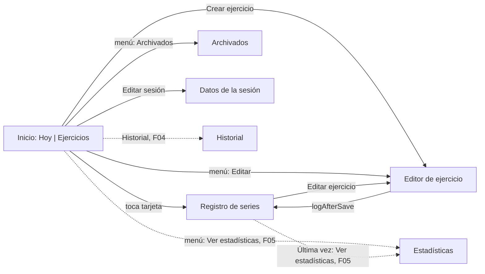

# Spec 42: Pantallas y navegación

Oct 11, 2026 · @Juan

| ID | Estado | Fase | Depende de |
| --- | --- | --- | --- |
| 42 | Aprobada | 3 UX y UI | 40, 41 |

## Propósito

Esta spec lleva los flujos de la Spec 40 a pantallas concretas. Fija:

- Qué pantallas hay, en qué paquete viven, su clave de navegación y qué spec F las construye.
- La pila de navegación, la pantalla inicial y el comportamiento de atrás.
- Cómo vuelve un resultado de una pantalla a otra y cómo llega un aviso a la pantalla de destino.
- El control del peso y de las repeticiones.
- Diálogos, avisos, estados vacíos, errores, formatos y transiciones.

Las specs F agregan el detalle. Esta spec les da lo que necesitan para no adivinar. Los wireframes y los textos son una guía, no reglas: el dueño va a iterar el diseño. Los valores visuales viven en la Spec 41.

El 2026-10-11 el dueño aceptó de antemano las recomendaciones. Todas las decisiones quedan cerradas con la opción recomendada y conservan sus alternativas.

## Decisiones del dueño tomadas como dadas

| Tema | Decisión | Fuente |
| --- | --- | --- |
| Inicio con tarjetas | La vista principal muestra cada ejercicio como una tarjeta grande, al estilo Material 3 Expressive: barra superior centrada, pestañas en píldora y tarjetas tonales redondeadas. Reemplaza a D1 de la Spec 40, que abría en la sesión de hoy | Dueño, 2026-10-11, imagen de referencia 2 |
| Tocar una tarjeta | Abre el registro de series de ese ejercicio en la sesión de hoy. La sesión se crea al guardar la primera serie | Dueño, 2026-10-11 |
| Tarjeta | Nombre, músculo o equipo, y el peso de la última vez con números anchos de Roboto Flex. Color por equipo en la dirección A | Dueño, 2026-10-11; Spec 41 |
| Control del peso | `Slider` sobre una ventana centrada en el valor propuesto, botones −/+ de 0,25 kg y escribir el valor con un toque. Igual para las repeticiones. TalkBack llega rápido a cualquier valor | Dueño, 2026-10-11, imagen de referencia 1 |
| Estadísticas | Pantalla por ejercicio en F05 (0.0.2), dibujada con `Canvas`, sin librería de gráficas | Dueño, 2026-10-11, imagen de referencia 3; Spec 01 |
| Diseño iterativo | Wireframes y visuales son guía, no reglas | Dueño, 2026-10-11 |
| Versiones | 0.0.1 = F00 a F03. 0.0.2 = F05. F04 llega después | Spec 01 |
| Navegación | Navigation 3. El shell posee la pila. Claves `@Serializable` con solo ids. Navegación por lambdas | ADR-30-10 |
| Paquetes | Pantallas en `feature/<feature>/ui/` con `XScreen`, `XContent`, `XViewModel` y `XUiState`. El shell en `ui/` | ADR-30-03 |
| Estado | Un `UiState` inmutable por pantalla. Efectos de una vez como campos del estado | ADR-30-07 |
| Última vez | F03 vive en su paquete. La pantalla de F02 tiene un hueco que el shell llena | D2 de la Spec 30 |
| Pruebas | UI y navegación instrumentadas en `src/androidTest`, sin Robolectric | Spec 31, D1 y S31-R16 |
| Sistema de diseño | Tokens, direcciones `VisualDirection`, movimiento, patrones y formatos de la Spec 41 | Spec 41 |
| Dispositivo | Solo teléfono | Spec 01 |

## Estructura de navegación

**Una sola pila.** El shell crea una pila con `rememberNavBackStack(HomeKey)` y la muestra con `NavDisplay` (S30-R37). No hay barra de navegación inferior ni pilas por pestaña (D1).

**Pantalla inicial.** El inicio (S42-P01), con dos pestañas internas: **Hoy** y **Ejercicios**. Las pestañas son estado del inicio, no entradas de la pila. La pestaña inicial es Hoy.



**Atrás.**

| Dónde | Atrás hace | Quién lo maneja |
| --- | --- | --- |
| Cualquier pantalla sobre el inicio, sin cambios sin guardar | Saca la entrada superior de la pila, con atrás predictivo | `NavDisplay` (`onBack = { backStack.removeLastOrNull() }`) |
| Formulario con cambios sin guardar | Muestra el diálogo "¿Descartar los cambios?" | Un solo `NavigationBackHandler` por pantalla, activo solo con cambios (D13) |
| Diálogo abierto | Cierra el diálogo sin hacer la acción | El propio diálogo de Compose |
| Inicio, pestaña Ejercicios | Vuelve a la pestaña Hoy | `NavigationBackHandler` del inicio, activo solo en Ejercicios (D10) |
| Inicio, pestaña Hoy | Sale de la app | El sistema: la pila tiene una sola entrada |

Esto resuelve el pedido de S31-R16: atrás saca la entrada superior; en el inicio, atrás vuelve a Hoy y desde Hoy sale de la app.

**Atrás predictivo.** `NavDisplay` lo da gratis. En API 33 a 35 hace falta `android:enableOnBackInvokedCallback="true"` en `<application>` del manifiesto; en API 36 o más viene activo (skill `navigation-event`). F00 lo agrega, con `tools:targetApi="33"` para que el lint no avise en el `minSdk` 26.

**Dependencia nueva.** `NavigationBackHandler` vive en `androidx.navigationevent:navigationevent-compose`. Hoy llega solo como dependencia de ejecución de `navigation3-ui` 1.2.0 (versión 1.1.1), así que no se puede usar al compilar. F00 la declara en `implementation` con la última estable, 1.2.0, verificada el 2026-10-11 en Google Maven (D13). El agente confirma de nuevo la versión antes de escribirla.

**Claves.** Cada feature declara sus claves en su `ui/` (S30-R38). Solo llevan ids y valores simples. Un id `0L` significa "nuevo" o "sin sesión todavía".

```kotlin
// feature/session/ui
@Serializable data object HomeKey : NavKey
@Serializable data class SetLoggerKey(val exerciseId: Long, val sessionId: Long = 0L) : NavKey
@Serializable data class SessionEditorKey(val sessionId: Long) : NavKey
// feature/catalog/ui
@Serializable data class ExerciseEditorKey(
    val exerciseId: Long = 0L,
    val prefillName: String = "",
    val logAfterSave: Boolean = false,
) : NavKey
@Serializable data object ArchivedExercisesKey : NavKey
// feature/progress/ui (F05)
@Serializable data class ExerciseProgressKey(val exerciseId: Long) : NavKey
```

**Resultado del editor al registro (D5).** No hay bus de resultados. El shell traduce el resultado a una operación sobre la pila:

- El editor llama a `onSaved(exerciseId)` cuando su `UiState` trae `savedExerciseId` (S30-R28). Lo mismo al desarchivar por D9.
- El shell saca el editor. Si la clave traía `logAfterSave = true`, agrega `SetLoggerKey(exerciseId)`.
- Desde el registro, "Editar ejercicio" abre el editor con `logAfterSave = false`. Al guardar, el shell solo saca el editor. El registro ya ve el nombre y la nota nuevos porque los observa en la base de datos.
- La pila se guarda con las claves, así que el resultado sobrevive a la muerte del proceso.

**Aviso en la pantalla de destino (D6).** Cuando una acción navega y deja algo que mostrar (archivar o eliminar desde el editor), el shell guarda un `PendingNotice` como estado con `rememberSaveable`. Lo pasa como parámetro al inicio, que lo entrega a su ViewModel con `onNotice(notice)` y luego llama a `onNoticeConsumed()`. El ViewModel lo pone en su `UiState` y la pantalla lo muestra en su `SnackbarHost`. No se usan `Channel` ni `SharedFlow` (S30-R28).

```kotlin
// ui/PendingNotice.kt (shell)
sealed interface PendingNotice {
    data class Archived(val exerciseId: Long, val name: String, val wasDeleteRequest: Boolean) : PendingNotice
    data class Deleted(val name: String) : PendingNotice
}
```

Archivar o eliminar desde el editor saca de la pila el editor y, si estaba debajo, el registro de ese ejercicio, porque un ejercicio archivado no recibe series nuevas (S40-R29) y uno eliminado ya no existe. El aviso aparece siempre en el inicio.

**Edge-to-edge.** `MainActivity` mantiene `enableEdgeToEdge()`. Cada pantalla tiene su `Scaffold` con su barra superior y su `SnackbarHost` (S41-R11). El shell no envuelve `NavDisplay` en otro `Scaffold` ni le pone padding. Las listas reciben el `innerPadding` en `contentPadding`. Los formularios con texto manejan el teclado con un solo método (skill `edge-to-edge`).

**Muerte del proceso.** La pila vuelve completa. Cada ViewModel vuelve a leer la base de datos. Solo se pierde lo no guardado de un formulario (D19 de la Spec 40) y la pestaña elegida del inicio, que vuelve a Hoy.

## Lista de pantallas

Rutas relativas a `com/juancholopes/weightrack/`. "Posterior" significa después de la 0.0.2, con F04.

| ID | Pantalla | Paquete | Clave | La construye | Versión | Flujos S40 |
| --- | --- | --- | --- | --- | --- | --- |
| S42-P01 | Inicio (Hoy y Ejercicios) | `feature/session/ui/home/` | `HomeKey` | F02 (D2) | 0.0.1 | F01, F02, F03, F08, F09, F10, F22, F23 |
| S42-P02 | Registro de series | `feature/session/ui/logger/` | `SetLoggerKey(exerciseId, sessionId)` | F02, con el hueco que llena F03 | 0.0.1 | F12, F13, F15, F16, F21, destino de F19 |
| S42-P03 | Editor de ejercicio | `feature/catalog/ui/editor/` | `ExerciseEditorKey(exerciseId, prefillName, logAfterSave)` | F01 | 0.0.1 | F04, F05, F06, F11, F21 |
| S42-P04 | Archivados | `feature/catalog/ui/archived/` | `ArchivedExercisesKey` | F01 | 0.0.1 | F07 |
| S42-P05 | Datos de la sesión | `feature/session/ui/sessioneditor/` | `SessionEditorKey(sessionId)` | F02 | 0.0.1 | F14, F21 |
| S42-P06 | Estadísticas del ejercicio | `feature/progress/ui/` | `ExerciseProgressKey(exerciseId)` | F05 | 0.0.2 | Ninguno (S01-R12) |
| S42-P07 | Historial | `feature/history/ui/` | `HistoryKey` | F04 | Posterior | F17 |
| S42-P08 | Sesión pasada (solo lectura) | `feature/history/ui/` | `PastSessionKey(sessionId)` | F04 | Posterior | F18, F20 |
| S42-P09 | Sesión (corregir una pasada) | `feature/session/ui/session/` | `SessionKey(sessionId)` | F02, entregada con F04 | Posterior | F19 |
| S42-P10 | Elegir ejercicio para una sesión pasada | `feature/session/ui/picker/` | `ExercisePickerKey(sessionId)` | F02, entregada con F04 | Posterior | F10 sobre una sesión pasada |

Pantalla de arranque temporal: mientras F02 no exista, F00 muestra en el shell una pantalla mínima (`ui/StartScreen`, clave `StartKey` en `ui/`) con el nombre de la app. F01 conecta allí, por el shell, "Crear ejercicio" y "Archivados". F02 la reemplaza por `HomeKey` y la borra.

Campos clave del `UiState` de cada pantalla. Los nombres son una guía; la spec F fija los definitivos.

| Pantalla | Campos clave |
| --- | --- |
| S42-P01 | `isLoading`, `today: LocalDate`, `selectedTab: HomeTab`, `todaySession: TodaySessionUi?` (id, fecha, nota), `todayCards`, `lastSessionDate`, `lastSessionCards`, `exerciseCards`, `query`, `muscleFilter`, `equipmentFilter`, `catalogIsEmpty`, `canStartAnotherSession`, `notice: HomeNotice?` |
| S42-P02 | `isLoading`, `exercise` (nombre, equipo, nota, archivado), `sessionDate`, `resolvedSessionId: Long?`, `todaySets: List<SetRowUi>`, `weight: ValueInput`, `reps: ValueInput`, `editingSetId: Long?`, `hasUnsavedChanges`, `isSaving`, `fieldError`, `typingDialog`, `confirmDialog`, `savedAnnouncement`, `genericError` |
| S42-P03 | `mode` (nuevo o editar), `name`, `equipment`, `muscles` (con `isPrimary`), `notes`, `hasSets: Boolean?`, `fieldError`, `archivedConflict`, `confirmDialog`, `hasUnsavedChanges`, `isSaving`, `savedExerciseId`, `archivedResult`, `deletedResult`, `genericError` |
| S42-P04 | `isLoading`, `items`, `notice` |
| S42-P05 | `date`, `today`, `notes`, `fieldError`, `showDatePicker`, `hasUnsavedChanges`, `isSaving`, `saved`, `genericError` |
| S42-P06 | `isLoading`, `exerciseName`, `isBodyweight`, `bars: List<BarUi>`, `page`, `canGoOlder`, `canGoNewer`, `headline`, `record`, `sessions`, `isEmpty` |

`ValueInput` guarda el valor en unidades del dominio (gramos o repeticiones), si el usuario lo fijó y el centro de la ventana del slider. Un valor no fijado nunca se guarda (S40-R26).

## Inicio (S42-P01)

Una pantalla con barra superior centrada ("Weightrack"), `PillTabs` con **Hoy** y **Ejercicios**, y un botón flotante extendido "Crear ejercicio" en las dos pestañas. El menú de la barra tiene "Archivados" y, si hay sesión de hoy, "Empezar otra sesión" (S40-F09). Con F04, la barra suma el icono "Historial".

```
+----------------------------------+     +----------------------------------+
|            Weightrack          : |     |            Weightrack          : |
|        ( Hoy )  Ejercicios       |     |         Hoy  ( Ejercicios )      |
|                                  |     | +------------------------------+ |
| Hoy · dom 11 oct           E     |     | | Q Buscar ejercicio           | |
| "Me sentí con energía"           |     | +------------------------------+ |
| +------------------------------+ |     | [Equipo ▾] [Músculo ▾]           |
| | Press de banca            :  | |     | +-------------+ +-------------+  |
| | Pecho · Barra                | |     | | Jalón     : | | Prensa    : |  |
| | 60 kg                        | |     | | Dorsales    | | Cuádriceps  |  |
| | 3 series hoy                 | |     | | 45 kg       | | 120 kg      |  |
| +------------------------------+ |     | | jue 8 oct   | | mar 6 oct   |  |
| De tu última sesión · jue 8 oct  |     | +-------------+ +-------------+  |
| +------------------------------+ |     | +-------------+ +-------------+  |
| | Remo en polea             :  | |     | | Remo polea :| | Sentadilla :|  |
| | Dorsales · Polea             | |     | | ...         | | Sin series  |  |
| | 50 kg · jue 8 oct            | |     | +-------------+ +-------------+  |
| +------------------------------+ |     |                                  |
| Ver todos los ejercicios ›       |     |               +----------------+ |
|               +----------------+ |     |               | + Crear ejerc. | |
|               | + Crear ejerc. | |     |               +----------------+ |
+----------------------------------+     +----------------------------------+
```

**Pestaña Hoy.**

- **Con sesión de hoy:** encabezado con la fecha ("Hoy · dom 11 oct"), la nota si hay y el botón "Editar sesión", que abre S42-P05. Debajo, una tarjeta por ejercicio con series en esta sesión, en el orden de su primera serie (D16 de la Spec 40). Cada una dice cuántas series lleva hoy.
- **De tu última sesión:** los ejercicios de la sesión más reciente anterior a hoy que todavía no tienen series hoy. Sale del historial (S10-R28) y de `observeSessionSets`, sin consultas nuevas.
- **Sin sesión de hoy:** el texto "Aún no tienes series hoy. Toca un ejercicio para empezar." y luego "De tu última sesión".
- **Enlace** "Ver todos los ejercicios", que cambia a la pestaña Ejercicios.
- La sesión de hoy es la más reciente con fecha de hoy, la de mayor `id` si hay varias (S10-R28).

**Pestaña Ejercicios.** Todos los ejercicios activos como tarjetas en una cuadrícula de dos columnas (`LazyVerticalGrid` con celdas adaptables), ordenados por nombre (S10-R30). Arriba, la búsqueda por nombre y los filtros por equipo y por músculo (D10 de la Spec 40). Es a la vez el catálogo (S40-F03) y la elección de ejercicio (S40-F10).

**Tarjeta (`ExerciseCard` de la Spec 41).**

| Parte | Contenido |
| --- | --- |
| Título | Nombre del ejercicio, hasta dos líneas |
| Subtítulo | Músculo principal y equipo: "Pecho · Barra". Con varios principales, el primero |
| Número | El mayor peso entre las series de la última vez del ejercicio, contando hoy (D11), con `NumberStyles.card`: "60 kg". En peso corporal: "+10 kg" o "Sin peso" |
| Pie | La fecha de esa sesión ("jue 8 oct"), o "3 series hoy" en Hoy. Sin series: "Sin series" y sin número |
| Tono | Por equipo, en la dirección A: máquina `Primary`, polea `Secondary`, mancuerna y barra `Tertiary`, peso corporal `Neutral`. El equipo también se lee en el subtítulo, así que no depende del color |
| Toque | Abre S42-P02 con `SetLoggerKey(exerciseId)` en la sesión de hoy |
| Menú ⋮ | "Editar ejercicio" y, con F05, "Ver estadísticas". También como acciones de accesibilidad |
| TalkBack | Un solo nodo: "Press de banca. Pecho, barra. Última vez jueves 8 de octubre, 60 kilogramos. Toca dos veces para registrar una serie." |

En Hoy, una tarjeta de un ejercicio archivado con series de hoy lleva la marca "Archivado". Abre el registro solo para corregir o eliminar sus series (S40-R29).

**Búsqueda y filtros.** Un campo de texto con icono de búsqueda y dos `FilterChip` con menú: "Equipo" (5 valores) y "Músculo" (14 valores). La búsqueda sigue la regla que pide la Spec 40 a la Spec 10: sin mayúsculas ni tildes. Sin resultados: "Ningún ejercicio coincide con «{texto}»." con "Crear «{texto}»" y "Limpiar búsqueda".

**Crear ejercicio.** El botón flotante abre S42-P03:

| Desde | Clave | Al guardar |
| --- | --- | --- |
| Hoy (botón o estado vacío) | `ExerciseEditorKey(logAfterSave = true)` | Abre el registro del nuevo ejercicio (S40-R25, S40-F22) |
| Ejercicios (botón) | `ExerciseEditorKey()` | Vuelve a Ejercicios y la tarjeta nueva se ve |
| Ejercicios, búsqueda sin resultados | `ExerciseEditorKey(prefillName = texto, logAfterSave = true)` | Abre el registro del nuevo ejercicio (S40-F11) |

**Una mano.** El botón flotante, las tarjetas y las pestañas quedan al alcance del pulgar. Las tarjetas miden mucho más de 48 dp.

## Registro de series (S42-P02)

La pantalla de una máquina: se registran, corrigen y eliminan las series de un ejercicio en una sesión. Tiene una parte que se desplaza arriba y un panel fijo abajo con el control y el botón de guardar, al alcance del pulgar.

```
+----------------------------------+
| <  Press de banca          E  : |
|    Hoy · dom 11 oct              |
| +------------------------------+ |
| | * Asiento en la posición 4  | |  nota fija (D13 de la Spec 40)
| +------------------------------+ |
| +------------------------------+ |
| | Última vez · jue 8 oct       | |  hueco de F03
| | 60 kg × 10 · 60 × 10 · 60 × 8| |
| | Ver estadísticas ›     (F05) | |
| +------------------------------+ |
| Hoy                              |
|  1   60 kg × 10                  |  tocar = corregir
|  2   60 kg × 10                  |
+----------------------------------+
| Peso                             |
| (−)        62,5 kg         (+)   |  número: tocar para escribir
| |##############||.............·| |  ventana 52,5 a 72,5 kg
| Repeticiones                     |
| (−)           10           (+)   |
| |########||..................·|  |
| +------------------------------+ |
| |         Guardar serie        | |
| +------------------------------+ |
+----------------------------------+
```

**Barra superior.** Atrás, el nombre del ejercicio y la fecha de la sesión. La fecha siempre se ve (S40-R23): "Hoy · dom 11 oct" o, en una sesión pasada, "jue 8 oct". Acciones: "Editar ejercicio" (abre S42-P03 con `logAfterSave = false`) y, con F05, "Ver estadísticas" en el menú.

**Sesión.** `SetLoggerKey.sessionId` es `0L` cuando se abre desde una tarjeta:

1. El ViewModel busca la sesión de hoy: la más reciente con fecha de hoy (S10-R28). Si existe, la usa.
2. Si no existe, no crea nada al abrir. Al tocar "Guardar serie", crea la sesión y la serie en una sola escritura con `createSession(session, sets)` (S20-R39). Desde ahí guarda el id en `resolvedSessionId`.
3. Con un `sessionId` distinto de `0L` (sesión pasada, con F04), usa esa sesión y nunca crea otra.

Si la medianoche pasa con la pantalla abierta, la siguiente serie va a la sesión de la fecha en que se abrió la pantalla, para no partir una serie del grupo. F02 lo prueba con `Clock.fixed`.

**Lista "Hoy".** Las series de este ejercicio en esta sesión, numeradas por su posición (S40-R23). Una serie nueva aparece al final y TalkBack la anuncia: "Serie 3 guardada: 60 kilogramos, 10 repeticiones." En una sesión pasada, el título de la lista es la fecha.

**Corregir una serie (D8).** Tocar una serie de la lista pone el panel en modo corrección:

- El panel dice "Corrigiendo la serie 2" y carga sus valores.
- El botón principal pasa a "Guardar cambios". Aparecen "Eliminar serie" y "Cancelar corrección".
- "Eliminar serie" abre el diálogo de la Spec 40. Al confirmar, la serie desaparece y el foco va a la serie de al lado o al título de la lista.
- Al guardar o cancelar, el panel vuelve a una serie nueva con los valores propuestos.

**Valores propuestos (D5 de la Spec 40).** La primera serie del ejercicio en la sesión propone la primera serie de la última vez. Las siguientes proponen la serie anterior de hoy. Después de guardar, el panel conserva los mismos valores: repetir una serie es un toque (S40-R27).

**Ejercicio archivado.** El panel no ofrece una serie nueva. Muestra "Este ejercicio está archivado. Desarchívalo en Archivados para registrar series." Las series de la lista se pueden corregir y eliminar (S40-R29).

**Hueco de la última vez (F03).** `SetLoggerScreen` recibe un parámetro composable que el shell llena (D2 de la Spec 30):

```kotlin
// feature/session/ui/logger/SetLoggerScreen.kt (F02)
fun SetLoggerScreen(
    onBack: () -> Unit,
    onEditExercise: (Long) -> Unit,
    onOpenProgress: ((Long) -> Unit)?,       // null hasta F05
    lastPerformance: @Composable (exerciseId: Long, sessionId: Long?, modifier: Modifier) -> Unit,
    viewModel: SetLoggerViewModel,
)

// ui/WeightrackApp.kt (shell)
lastPerformance = { exerciseId, sessionId, modifier ->
    LastPerformanceSection(exerciseId, sessionId, onOpenProgress = progressOrNull, modifier = modifier)
}
```

- `sessionId` es `resolvedSessionId`: con una sesión, la última vez excluye esa sesión y las posteriores (S10-R26). Sin sesión de hoy todavía, es `null` y la última vez es la sesión más reciente.
- `LastPerformanceSection` vive en `feature/lastperformance/ui/` con su propio ViewModel, creado con una clave que incluye `exerciseId` y `sessionId`.
- Muestra "Última vez · jue 8 oct" y las series en orden, con el formato corto "60 kg × 10". Sin datos: "Primera vez con este ejercicio."
- Mientras carga, reserva su alto para que el panel no salte.
- Con F05, muestra el enlace "Ver estadísticas", que abre S42-P06.
- TalkBack lo lee como un encabezado y un solo nodo: "Última vez, jueves 8 de octubre: 60 kilogramos, 10 repeticiones; ...".
- F02 no importa `lastperformance` (S30-R10). F02 lee la última vez por su cuenta solo para proponer valores.

**Orden del foco.** Ejercicio, nota fija, última vez, lista de hoy, peso, repeticiones y "Guardar serie" (S40-R48).

**Fuente al 200 %.** La parte de arriba se desplaza y el panel inferior se mantiene. Si el panel no cabe, el control de repeticiones pasa a la parte que se desplaza y "Guardar serie" queda siempre visible (S41-A11).

## Control del peso y las repeticiones

Un componente sin estado, `ValueAdjuster`, en `feature/session/ui/logger/`, porque solo lo usa F02 (Spec 41). Se usa dos veces: peso y repeticiones (D7).

| Pieza | Peso | Repeticiones |
| --- | --- | --- |
| Número grande | `WeightNumber` con `NumberStyles.hero`: "62,5 kg". Es un botón: tocarlo abre el diálogo para escribir | Igual: "10" |
| Botones − y + | Bajan o suben 0,25 kg. Mantener pulsado repite, como atajo | Bajan o suben 1 |
| `Slider` | Ventana de 20 kg centrada en el valor de referencia, con paradas cada 1,25 kg (16 tramos, 15 marcas). Es el ajuste grueso: discos de 1,25 y 2,5 kg | Ventana de 20 repeticiones centrada en la referencia, con paradas cada 1 |
| Escribir | Diálogo "Escribe el peso" con teclado decimal y sufijo "kg". Acepta coma o punto | Diálogo "Escribe las repeticiones" con teclado numérico |
| Límites | 0 a 1000 kg. La ventana se recorta en los extremos | 1 a 999 |

**Ventana del slider.**

- El valor de referencia es el valor propuesto o el de la serie que se corrige. La ventana se centra en ese valor redondeado a la parada más cercana, así que las paradas del peso siempre son múltiplos de 1,25 kg.
- Durante el arrastre la ventana no se mueve. Al soltar, o al cambiar el valor con −/+ o escribiéndolo, la ventana se vuelve a centrar en el valor nuevo. Así el slider siempre tiene margen a los dos lados.
- El slider cambia el valor solo en sus paradas. Con −/+ o escribiendo, el valor puede quedar entre paradas; la manija se dibuja en su posición exacta.
- Los tamaños de ventana y de parada son tokens ajustables en `ValueAdjuster`, no reglas.
- El `Slider` de `material3` 1.4.0 ya dibuja el estilo de la referencia: pista gruesa, manija de barra, hueco y marcas (Spec 41).

**Sin valor propuesto.** El número muestra "—" con el texto "Fija el peso". La ventana se centra en 20 kg (o en 10 repeticiones). El primer arrastre, toque en −/+ o valor escrito fija el valor; −/+ parten del centro de la ventana. En peso corporal el peso adicional parte de 0 y siempre tiene valor (S40-R26).

**Nada se redondea en silencio (S40-R08).** El diálogo rechaza un peso que no es múltiplo de 0,25 o pasa de 1000 kg, con el error de la Spec 40 junto al campo, y no cierra. −/+ y el slider no pueden producir un valor inválido. En los extremos, el botón que saldría del rango se desactiva.

**TalkBack (S40-R49).** Cualquier valor se alcanza en pocos pasos:

| Nodo | Etiqueta y acción |
| --- | --- |
| Número | "Peso, 62,5 kilogramos. Botón. Toca dos veces para escribirlo." Escribir un valor toma unos seis gestos, sin importar la distancia |
| − y + | "Bajar 0,25 kilogramos" y "Subir 0,25 kilogramos". Áreas de 48 dp como mínimo |
| `Slider` | Valor leído con su unidad (`stateDescription`: "62,5 kilogramos"). Deslizar arriba o abajo mueve una parada (1,25 kg) |
| Panel | Encabezados "Peso" y "Repeticiones" para saltar entre ellos |

**Por qué no un slider de 0 a 1000 kg.** Son 4000 posiciones en unos 300 dp: menos de 0,1 dp por paso, imposible de usar con el dedo, y miles de pasos con TalkBack.

## Editor de ejercicio y otros formularios

Los formularios son pantallas completas, no hojas ni diálogos (D9). Todos tienen guardado explícito y un solo `NavigationBackHandler`, activo solo con cambios sin guardar (S40-R40).

**Editor de ejercicio (S42-P03).**

```
+----------------------------------+
| x  Nuevo ejercicio               |  "Editar ejercicio" al editar
| +------------------------------+ |
| | Nombre                       | |
| | Press de banca               | |
| +------------------------------+ |
| Equipo                           |
| [Máquina] [Polea] [Mancuerna]    |  un solo valor
| [(Barra)] [Peso corporal]        |
| Músculos                         |
| [(Pecho)] [(Tríceps)] [Hombros]... |  varios valores
|  Pecho      [x] Principal          |  por músculo elegido
|  Tríceps    [ ] Principal          |
| +------------------------------+ |
| | Nota fija (opcional)         | |
| | Asiento en la posición 4     | |
| +------------------------------+ |
| Archivar ejercicio               |  o "Eliminar ejercicio" (D8 de la Spec 40)
| +------------------------------+ |
| |       Guardar ejercicio      | |
| +------------------------------+ |
+----------------------------------+
```

- Equipo: `FilterChip` de selección única. Músculos: `FilterChip` de selección múltiple, que no permite repetir (S10-R08). Cada músculo elegido tiene un interruptor "Principal"; el primero elegido empieza como principal (S40-R16).
- La marca de principal se lee como texto, no solo por color (S40-R49).
- Errores junto a su campo o debajo de su grupo, con región en vivo (Spec 41). Tras un guardado fallido, el foco va al campo con error.
- Nombre de un archivado al crear: diálogo "«Press de banca» está archivado" con "Desarchivar" y "Usar otro nombre" (D9 de la Spec 40). Desarchivar llama a `onSaved(id)` como si se hubiera creado.
- "Archivar ejercicio" actúa al momento: el shell vuelve al inicio con el aviso y "Deshacer" (D6). "Eliminar ejercicio" pide confirmar y vuelve al inicio con el aviso.
- La pantalla maneja el teclado con un solo método y se desplaza; "Guardar ejercicio" queda visible con el teclado abierto.

**Archivados (S42-P04).** Lista por nombre con un botón "Desarchivar" en cada fila. Desarchivar actúa al momento y muestra el aviso "«Press de banca» volvió al catálogo" en esta misma pantalla. Vacío: "No tienes ejercicios archivados. Los que archives aparecerán aquí."

**Datos de la sesión (S42-P05).** Campo de fecha que abre un `DatePickerDialog` con los días futuros desactivados (`selectableDates`, S10-R32), campo de nota y "Guardar". Si la fecha deja de ser hoy, al volver la sesión sale de Hoy y queda en el historial.

## Estadísticas del ejercicio (S42-P06)

F05, versión 0.0.2. Se abre desde el menú de una tarjeta y desde el enlace de la última vez. Antes de F05 esos accesos no existen: las lambdas llegan como `null` y la interfaz los oculta.

```
+----------------------------------+
| <  Press de banca                |
| Últimas 8 sesiones     (‹) (›)   |
| 80 kg  peso más alto, dom 11 oct |  número grande
| Récord personal: 82,5 kg · 2 sep |
|                              90  |
| - - - - - - - - - - - - - -  82,5|  línea del récord
|        *              *          |  galleta = récord
|  __   |#|   __   __  |#|  __  |#||
| |#|  |#|  |#|  |#|  |#|  |#|  |#||
| |#|  |#|  |#|  |#|  |#|  |#|  |#||   0
| 4 ago 9 ago 16 ago ... 2 sep ... 11 oct
| Sesiones                         |
| dom 11 oct · 80 kg × 8, 75 × 10  |
| jue 8 oct  · 77,5 kg × 8 ...       |
+----------------------------------+
```

Correspondencia con la referencia 3:

| Referencia | En Weightrack |
| --- | --- |
| Barras en píldora | Una barra por sesión que contiene el ejercicio: el peso más alto de esa sesión |
| Navegación por semana | Páginas de 8 sesiones: "‹" más antiguas, "›" más recientes. La primera página es la más reciente |
| Número grande | El peso más alto de la sesión más reciente de la página |
| Línea de meta | La línea del récord personal vigente, con su valor |
| Galleta con marca | Récord personal: una sesión cuyo peso más alto supera el de todas las anteriores. La primera sesión no cuenta como récord |
| Barras de color distinto | Las barras de récord usan `tertiary` y llevan la galleta. Las demás, `primary` |

- **Datos.** Todo sale de la evolución (S10-R27, `observeEvolution`). El peso más alto por sesión y los récords se calculan sin consultas nuevas. F05 decide si esas funciones viven en un `domain/` propio, y la Spec 10 define los términos (ver "Cambios").
- **Peso corporal.** Las barras muestran el peso adicional. Si todas sus series tienen 0 kg, la pantalla muestra las repeticiones más altas por sesión. F05 lo confirma.
- **Dibujo.** `Canvas` con `drawRoundRect` y radio completo para las píldoras. La galleta es un `Path` propio, sin `graphics-shapes` (Spec 41). Sin librería de gráficas.
- **Accesibilidad.** Cada barra es un nodo de semántica: "jueves 8 de octubre, 80 kilogramos, récord personal". La lista "Sesiones" debajo repite los datos como texto. El récord se marca con forma y texto, no solo con color.
- **Vacío.** Sin series: "Aún no hay series de este ejercicio. Registra una y aquí verás su progreso." Con una sola sesión: una barra, sin récord.

## Diálogos, avisos, vacíos, errores y formatos

Siguen los patrones de la Spec 41 (`ConfirmDialog`, `EmptyState`, un `SnackbarHost` por pantalla) y los textos de la Spec 40. Esta tabla dice en qué pantalla aparece cada uno.

**Diálogos.** Si un diálogo está abierto lo dice el `UiState`. Atrás o tocar fuera cancela.

| Diálogo | Pantalla | Botones |
| --- | --- | --- |
| ¿Descartar los cambios? | P02, P03, P05 | "Descartar" / "Seguir editando" |
| ¿Eliminar esta serie? | P02 | "Eliminar serie" / "Conservar" |
| ¿Eliminar «Remo con mancuerna»? | P03 | "Eliminar ejercicio" / "Conservar" |
| «Press de banca» está archivado | P03 | "Desarchivar" / "Usar otro nombre" |
| Escribe el peso / las repeticiones | P02 | "Fijar peso" o "Fijar repeticiones" / "Cancelar" |
| Fecha de la sesión | P05 | `DatePickerDialog`: "Elegir" / "Cancelar" |
| ¿Eliminar la sesión del jue 8 oct? | P08 (F04) | "Eliminar sesión" / "Conservar" |

**Avisos.** Solo con algo que deshacer o con un resultado que no se ve (S40-R43).

| Aviso | Aparece en | Acción |
| --- | --- | --- |
| "«Press de banca» archivado" | P01, tras archivar en P03 | "Deshacer" (desarchiva) |
| "«Press de banca» tiene series, así que se archivó" | P01, tras eliminar en P03 | "Deshacer" |
| "«Remo con mancuerna» eliminado" | P01, tras eliminar en P03 | Ninguna |
| "«Press de banca» volvió al catálogo" | P04 | Ninguna |
| "Sesión eliminada" | P07 (F04) | Ninguna |
| "No se pudo guardar. Tus datos siguen aquí; inténtalo de nuevo." | La pantalla que falló | Ninguna: se reintenta con el mismo botón |

Guardar una serie no muestra aviso: la serie aparece y TalkBack la anuncia con una región en vivo.

**Estados vacíos.** Mientras el `UiState` no tiene su primer dato, la pantalla no muestra su estado vacío (Spec 41).

| Dónde | Texto | Acción |
| --- | --- | --- |
| P01, sin ejercicios (las dos pestañas) | "Aún no tienes ejercicios. Crea uno para registrar su primera serie." | "Crear ejercicio" |
| P01 Hoy, sin series hoy | "Aún no tienes series hoy. Toca un ejercicio para empezar." | Ninguna (las tarjetas están debajo) |
| P01 Hoy, sin series hoy ni sesiones anteriores | El texto anterior | "Ver todos los ejercicios" |
| P01 Ejercicios, búsqueda sin resultados | "Ningún ejercicio coincide con «{texto}»." | "Crear «{texto}»" / "Limpiar búsqueda" |
| P02, última vez sin datos | "Primera vez con este ejercicio." | Ninguna |
| P04 | "No tienes ejercicios archivados. Los que archives aparecerán aquí." | Ninguna |
| P06 | "Aún no hay series de este ejercicio. Registra una y aquí verás su progreso." | Ninguna |

**Errores en línea.** Junto a su campo, con `isError` y `supportingText`, o debajo del grupo con semántica de error y región en vivo (Spec 41). Los textos son los de la Spec 40. Uno nuevo para el diálogo de escribir: "Escribe un número, por ejemplo 62,5."

**Formatos.** Desde `ui/theme/Formats.kt` (Spec 41), en español y en kilogramos.

| Valor | Se ve | TalkBack |
| --- | --- | --- |
| Peso | "62,5 kg", "60 kg", "62,25 kg", "1000 kg" | "62,5 kilogramos" |
| Peso adicional | "+10 kg"; sin peso: "Sin peso" | "10 kilogramos adicionales" |
| Serie | "60 kg × 10"; en una lista del mismo ejercicio se puede abreviar "60 × 10" tras la primera | "60 kilogramos, 10 repeticiones" |
| Fecha | "jue 8 oct", "Hoy · dom 11 oct", "Ayer"; año solo si no es el actual | "jueves 8 de octubre" |
| Escribir un peso | Acepta "62,5" y "62.5". Muestra coma | — |

**Textos nuevos de esta spec.** Revisados con la skill `ux-copy`: cortos, con verbo y en tú. Son sugerencias; los finales viven en `strings.xml`.

| Elemento | Texto |
| --- | --- |
| Pestañas | "Hoy" / "Ejercicios" |
| Botón flotante | "Crear ejercicio" |
| Encabezado de Hoy | "Hoy · {fecha}" |
| Sección | "De tu última sesión · {fecha}" |
| Enlace | "Ver todos los ejercicios" |
| Pie de tarjeta | "{n} series hoy" / "Sin series" |
| Acción de la tarjeta | "Registrar una serie" (para TalkBack) |
| Menú de la tarjeta | "Editar ejercicio" / "Ver estadísticas" |
| Menú del inicio | "Archivados" / "Empezar otra sesión" |
| Botón de la sesión | "Editar sesión" |
| Corrección | "Corrigiendo la serie {n}" / "Guardar cambios" / "Cancelar corrección" |
| Peso sin valor | "Fija el peso" |
| Estadísticas | "Últimas {n} sesiones" / "Peso más alto" / "Récord personal" / "Ver estadísticas" |

## Transiciones

El shell pasa a `NavDisplay` los parámetros `transitionSpec`, `popTransitionSpec` y `predictivePopTransitionSpec` (receta `animations` de la skill `navigation-3`). Leen los resortes de `WeightrackTheme.motion` (Spec 41) y `rememberReducedMotion()`. Así cambian solos con la dirección visual (D14).

| Momento | Movimiento normal | Con movimiento reducido |
| --- | --- | --- |
| Avanzar a una pantalla | Eje compartido X: la nueva entra desde la derecha un 10 % del ancho con resorte espacial normal, y aparece con resorte de efectos normal. La anterior sale un poco a la izquierda y se funde | Solo fundido, con resorte de efectos rápido |
| Volver | Lo inverso | Solo fundido |
| Atrás predictivo | La pantalla sigue al gesto con el valor por defecto de `NavDisplay`, con la anterior visible debajo | Fundido sin escala |
| Cambiar de pestaña en el inicio | El relleno de la píldora se mueve con resorte espacial rápido; el contenido hace un fundido cruzado | Cambio de color y de contenido sin movimiento |
| Pulsar una tarjeta | Escala 0,96 y cambio de tono (dirección A) | Solo cambio de tono |
| Cambiar el peso o las repeticiones | Los dígitos ruedan y el número se ensancha un instante (Spec 41) | El número cambia de golpe |
| Serie nueva en la lista | `animateItem`: aparece con fundido y se acomoda | Solo fundido |
| Barras de estadísticas | Crecen desde la base al aparecer; al cambiar de página, fundido cruzado | Aparecen sin crecer |
| Diálogos y avisos | Los de Material 3, sin cambios | Los de Material 3 |

Nada se repite en bucle. No hay paralaje ni se animan tamaños de layout (Spec 41). Ninguna pantalla cambia su transición en la 0.0.1; si una lo necesita, lo hace con los metadatos de su `entry`.

## De los flujos a las pantallas

Cada flujo de la Spec 40, la pantalla que lo cubre y su versión. Los flujos marcados con "Cambiado" siguen la enmienda del 2026-10-11 en la Spec 40.

| Flujo | Pantallas | Versión | Nota |
| --- | --- | --- | --- |
| S40-F01 Abrir la app | P01 Hoy | 0.0.1 | Cambiado: inicio con tarjetas |
| S40-F02 Moverse, volver y salir | Shell, P01 | 0.0.1 | Ver "Atrás" |
| S40-F03 Ver y buscar en el catálogo | P01 Ejercicios | 0.0.1 | Tocar una tarjeta registra; editar va en su menú (ver "Cambios") |
| S40-F04 Crear un ejercicio | P03 | 0.0.1 | Origen según `logAfterSave` |
| S40-F05 Editar un ejercicio | P03 | 0.0.1 | Desde el menú de la tarjeta o desde P02 |
| S40-F06 Archivar o eliminar | P03, aviso en P01 | 0.0.1 | D6 |
| S40-F07 Archivados | P04 | 0.0.1 | Desde el menú de P01 |
| S40-F08 Sesión de hoy | P01, P02 | 0.0.1 | Cambiado: la sesión se crea con la primera serie |
| S40-F09 Otra sesión el mismo día | P01 (menú) | 0.0.1 | Crea la sesión al momento y Hoy la muestra |
| S40-F10 Elegir un ejercicio | P01 | 0.0.1 | Cambiado: la tarjeta es la elección |
| S40-F11 Crear desde la sesión | P01, P03, P02 | 0.0.1 | `logAfterSave = true` |
| S40-F12 Registrar una serie | P02 | 0.0.1 | Control de D7 |
| S40-F13 Corregir o eliminar una serie | P02 (modo corrección) | 0.0.1 | D8 |
| S40-F14 Fecha y nota de la sesión | P05 | 0.0.1 | Desde "Editar sesión" en Hoy |
| S40-F15 Salir de la sesión | P02, P01 | 0.0.1 | Atrás vuelve al inicio |
| S40-F16 Última vez | Hueco de P02 | 0.0.1 | F03 |
| S40-F17 Historial | P07 | Posterior | Icono en la barra de P01 |
| S40-F18 Sesión pasada | P08 | Posterior | |
| S40-F19 Corregir una sesión pasada | P09, P10, P02 | Posterior | P02 con `sessionId` explícito |
| S40-F20 Eliminar una sesión | P08 | Posterior | |
| S40-F21 Cambios sin guardar | P02, P03, P05 | 0.0.1 | D13 |
| S40-F22 Primer uso | P01, P03, P02 | 0.0.1 (sin el paso 6) | Hoy vacío, "Crear ejercicio", registro |
| S40-F23 Sesión típica | P01, P02 | 0.0.1 | Cambiado: dos toques hasta la primera serie |

## Requisitos

| ID | Requisito |
| --- | --- |
| S42-R01 | Las pantallas, sus paquetes, claves y specs F son las de "Lista de pantallas". Una pantalla nueva se agrega a esa tabla con una enmienda. |
| S42-R02 | Hay una sola pila, creada con `rememberNavBackStack(HomeKey)` en el shell. No hay pilas por pestaña ni barra de navegación inferior. |
| S42-R03 | El inicio (S42-P01) es la pantalla inicial. Tiene las pestañas Hoy y Ejercicios como estado de su `UiState`, con Hoy por defecto. |
| S42-R04 | Atrás sigue la tabla "Atrás": saca la entrada superior; en Ejercicios vuelve a Hoy; en Hoy sale de la app. |
| S42-R05 | El manifiesto declara `android:enableOnBackInvokedCallback="true"` en `<application>`. |
| S42-R06 | Cada pantalla con formulario o con la pestaña Ejercicios tiene un solo `NavigationBackHandler` (`navigationevent-compose`), activo solo cuando hay cambios sin guardar o cuando la pestaña elegida es Ejercicios. Sin él activo, atrás conserva el atrás predictivo. |
| S42-R07 | Las claves siguen el bloque "Claves": `@Serializable`, implementan `NavKey`, solo llevan ids y valores simples, y viven en el `ui/` de su feature. |
| S42-R08 | El resultado del editor vuelve por la pila: al guardar o desarchivar, el shell saca el editor y, si `logAfterSave` es `true`, agrega `SetLoggerKey(exerciseId)`. |
| S42-R09 | Un aviso que nace en una pantalla y se muestra en otra viaja como `PendingNotice` en estado guardable del shell, nunca por `Channel`, `SharedFlow` ni `LiveData`. Archivar o eliminar desde el editor vuelve al inicio con el aviso. |
| S42-R10 | Cada pantalla tiene su `Scaffold`, su barra superior y su `SnackbarHost`. El shell no agrega `Scaffold` ni padding alrededor de `NavDisplay`. Las listas usan el `innerPadding` como `contentPadding`. |
| S42-R11 | Tocar una tarjeta abre `SetLoggerKey(exerciseId)` sin escribir nada. La sesión de hoy es la más reciente con fecha de hoy (S10-R28). Sin sesión de hoy, la sesión se crea junto con la primera serie, en una sola escritura (S20-R39). |
| S42-R12 | Una tarjeta muestra nombre, músculo principal y equipo, el mayor peso de la última vez contando hoy (o "Sin series"), la fecha de esa sesión, un tono por equipo y un menú con "Editar ejercicio" (y "Ver estadísticas" con F05). Todo lo que dice el color también lo dice el texto. |
| S42-R13 | Hoy muestra la sesión de hoy (fecha, nota, "Editar sesión" y sus ejercicios) y los ejercicios de la última sesión anterior que no tienen series hoy. Ejercicios muestra el catálogo activo con búsqueda y filtros. |
| S42-R14 | "Crear ejercicio" está en las dos pestañas. Desde Hoy y desde una búsqueda sin resultados, al guardar se abre el registro del ejercicio nuevo; desde el botón de Ejercicios, se vuelve a Ejercicios. |
| S42-R15 | El registro de series muestra la fecha de la sesión, la nota fija, el hueco de la última vez, las series de este ejercicio en esta sesión y el panel con el control y "Guardar serie", en ese orden de foco. |
| S42-R16 | `SetLoggerScreen` recibe la última vez como parámetro composable con `exerciseId`, `sessionId` y `Modifier`. El shell lo llena con `LastPerformanceSection` de `feature/lastperformance/ui`. `session` no importa `lastperformance`. |
| S42-R17 | Tocar una serie del registro la corrige en el mismo panel, con "Guardar cambios", "Eliminar serie" y "Cancelar corrección". |
| S42-R18 | El control del peso tiene un número que se toca para escribir, botones −/+ de 0,25 kg y un `Slider` sobre una ventana de 20 kg con paradas de 1,25 kg, que se recentra al soltar o al cambiar el valor de otra forma. Las repeticiones usan el mismo control con pasos de 1 y una ventana de 20. |
| S42-R19 | El control nunca produce ni guarda un valor fuera de 0 a 1000 kg, no múltiplo de 0,25 kg, o fuera de 1 a 999 repeticiones, ni un valor que el usuario no fijó. Escribir un valor inválido muestra el error y no lo redondea. |
| S42-R20 | Con TalkBack, el número, −, + y el slider tienen etiqueta y valor con unidad, y cualquier valor se alcanza escribiéndolo desde el número. |
| S42-R21 | Los formularios (P03, P05) son pantallas completas con guardado explícito. P05 no permite elegir días futuros. |
| S42-R22 | La pantalla de estadísticas (F05) muestra una barra por sesión con su peso más alto, en páginas de 8 sesiones, el número grande, la línea del récord vigente y una galleta en cada récord personal. Se dibuja con `Canvas` y `Path`, sin librerías nuevas. |
| S42-R23 | Cada barra de estadísticas es un nodo de semántica con fecha, peso y récord, y una lista de sesiones repite los datos como texto. |
| S42-R24 | Antes de F05, los accesos a estadísticas no se muestran. Antes de F04, el acceso al historial no se muestra. Los accesos llegan como lambdas que pueden ser `null`. |
| S42-R25 | Diálogos, avisos y estados vacíos siguen las tablas de "Diálogos, avisos, vacíos, errores y formatos" y los patrones de la Spec 41. Ninguna pantalla muestra su estado vacío antes de su primer dato. |
| S42-R26 | Pesos, series y fechas usan `Formats.kt` de la Spec 41, en español, en kilogramos y con precisión de 0,25 kg. |
| S42-R27 | Las transiciones siguen la tabla "Transiciones", con los resortes de la Spec 41. Con movimiento reducido, solo hay fundidos y cambios de golpe. |
| S42-R28 | La acción principal de Hoy ("Crear ejercicio" o una tarjeta) y "Guardar serie" se ven y se pueden tocar con la fuente al 200 %. |

## Decisiones

Todas cerradas el 2026-10-11 con la opción recomendada.

- [x] **D1. Estructura de nivel superior.** Decidido el 2026-10-11: A, una sola pila con pestañas dentro del inicio (el dueño aceptó de antemano las recomendaciones). A: pestañas Hoy y Ejercicios como estado del inicio. B: barra inferior con una pila por pestaña (receta `multiple-backstacks`). C: cada área como destino propio. Por qué A: es la referencia del dueño, tiene pocas áreas y las pruebas de atrás quedan simples. B suma código propio para pilas múltiples sin necesidad. C pierde el cambio rápido entre Hoy y Ejercicios.
- [x] **D2. Dueño del inicio.** Decidido el 2026-10-11: A, F02 en `feature/session/ui/home/` (el dueño aceptó de antemano las recomendaciones). A: el inicio es de `session`, que puede leer `catalog.domain` (S30-R10). B: un marco en el shell con huecos para cada pestaña. C: la pestaña Ejercicios en `catalog`, con una lectura del peso que cruce a las tablas de sesiones. Por qué A: tocar una tarjeta es un flujo de F02 y el peso de la tarjeta es un dato de sesiones. B obliga al shell a tener estado y ViewModels de features. C esconde una dependencia de `catalog` hacia `session` (S30-R10, S01-R09). Costo: F01 no tiene una lista propia; hasta F02 llega a sus pantallas desde la pantalla de arranque temporal.
- [x] **D3. Nombre de la segunda pestaña.** Decidido el 2026-10-11: A, "Ejercicios" (el dueño aceptó de antemano las recomendaciones). A: "Ejercicios". B: "Máquinas", el ejemplo del dueño. Por qué A: el glosario prohíbe "Máquina" como entidad aparte (Spec 02); solo es un valor del equipo. Costo: ninguno; el dueño puede cambiar el texto en `strings.xml` con una enmienda del glosario.
- [x] **D4. Cuándo se crea la sesión.** Decidido el 2026-10-11: A, al guardar la primera serie desde una tarjeta (el dueño aceptó de antemano las recomendaciones; decisión del dueño). A: abrir el registro no escribe; la primera serie crea la sesión con `createSession(session, sets)`. "Empezar otra sesión" crea la sesión al momento, porque es una acción explícita. B: crear la sesión al tocar la tarjeta. Por qué A: mirar una tarjeta no deja sesiones vacías. B llenaría el historial de sesiones vacías. Costo: D3 de la Spec 40 queda por alinear (ver "Cambios"; aplicado el 2026-10-11).
- [x] **D5. Resultado del editor al registro.** Decidido el 2026-10-11: A, por la pila con `logAfterSave` en la clave (el dueño aceptó de antemano las recomendaciones). A: el shell cambia la pila según la clave. B: la receta `results-event`. C: la receta `results-state`. Por qué A: sobrevive a la muerte del proceso y no necesita código nuevo. B usa un `Channel`, que prohíbe S30-R28, y B y C pierden el resultado al morir el proceso (lo dicen sus recetas). Costo: un campo más en la clave del editor.
- [x] **D6. Aviso en la pantalla de destino.** Decidido el 2026-10-11: A, `PendingNotice` guardable en el shell (el dueño aceptó de antemano las recomendaciones). A: estado del shell pasado como parámetro al inicio. B: un bus de eventos. C: el aviso dentro de la clave del inicio. Por qué A: es estado, no evento (S30-R28), y sobrevive a la muerte del proceso. B usa un `Channel`. C cambia la clave raíz y recrea su ViewModel. Costo: el shell guarda un dato pequeño.
- [x] **D7. Control del peso.** Decidido el 2026-10-11: A, número que se escribe, −/+ de 0,25 kg y `Slider` sobre una ventana de 20 kg con paradas de 1,25 kg (el dueño aceptó de antemano las recomendaciones). B: un `Slider` de 0 a 1000 kg. C: una rueda de números. D: solo un campo de texto. Por qué A: es la composición que pidió el dueño; el slider da el ajuste grueso sin teclado, −/+ el fino y escribir llega a cualquier valor con TalkBack. B tiene 4000 posiciones en 300 dp. C no es un componente de Material 3. D abre el teclado en el camino rápido (S40-R01). Costo: un componente propio en `session/ui`.
- [x] **D8. Corregir una serie.** Decidido el 2026-10-11: A, en el mismo registro (el dueño aceptó de antemano las recomendaciones). A: modo corrección en el panel. B: una pantalla aparte. C: una hoja inferior. Por qué A: la serie, la última vez y el control ya están ahí, y no hay otra pila que manejar. Costo: el panel tiene dos modos.
- [x] **D9. Formularios.** Decidido el 2026-10-11: A, pantallas completas (el dueño aceptó de antemano las recomendaciones). A: P03 y P05 como pantallas. B: hojas inferiores. C: destinos de diálogo con `DialogSceneStrategy`. Por qué A: atrás, el teclado y la fuente grande funcionan sin casos especiales. B y C complican el teclado y el atrás con cambios. Costo: más movimiento entre pantallas.
- [x] **D10. Atrás en Ejercicios.** Decidido el 2026-10-11: A, vuelve a Hoy (el dueño aceptó de antemano las recomendaciones). A: atrás en Ejercicios cambia a Hoy. B: atrás sale de la app desde cualquier pestaña. Por qué A: cumple S40-R10 (de un área a la de partida) y S31-R16 (se sale por la pantalla inicial). Costo: un `NavigationBackHandler` en el inicio.
- [x] **D11. Número de la tarjeta.** Decidido el 2026-10-11: A, el mayor peso de la última vez, contando hoy (el dueño aceptó de antemano las recomendaciones). A: el peso de trabajo de la sesión más reciente. B: el peso de la última serie guardada. C: el valor que propondrá el registro. Por qué A: es el peso que el usuario recuerda de esa máquina y coincide con las barras de F05. B cambia con una serie de calentamiento o de bajada. C cambia según cuántas series lleva hoy. Costo: una lectura nueva para todos los ejercicios en una consulta (ver "Cambios").
- [x] **D12. Estadísticas.** Decidido el 2026-10-11: A, barras por sesión en páginas de 8, línea del récord y galletas, con `Canvas` (el dueño aceptó de antemano las recomendaciones). B: barras por semana como la referencia. C: una librería de gráficas. Por qué A: un ejercicio se entrena una o dos veces por semana, así que las semanas tendrían una o dos barras. C exige un ADR y una dependencia (constitución, regla 3). Costo: dibujo propio.
- [x] **D13. Manejador de atrás.** Decidido el 2026-10-11: A, `NavigationBackHandler` de `navigationevent-compose` 1.2.0 (el dueño aceptó de antemano las recomendaciones). A: declararlo en `implementation`. B: `BackHandler` de `activity-compose`. Por qué A: lo pide la skill `navigation-event`; B es la API anterior. La versión de ejecución sube de 1.1.1 a 1.2.0 dentro de la misma línea 1.x. Costo: una dependencia declarada.
- [x] **D14. Transiciones.** Decidido el 2026-10-11: A, eje compartido X con los resortes de la Spec 41 (el dueño aceptó de antemano las recomendaciones). B: los valores por defecto de `NavDisplay`. C: sin animación. Por qué A: sigue la dirección visual y respeta el movimiento reducido. B no cambia con la dirección. C se siente brusco. Costo: tres especificaciones de transición en el shell.

## Fuera de alcance

- Deep links y accesos directos (S31-R16).
- Tablets, plegables, Scenes de dos paneles y `material3-adaptive-navigation3` (Spec 01, ADR-30-10).
- Pantalla de ajustes, selector de tema o de dirección (Spec 41).
- Metas de peso: la línea de la referencia 3 se usa para el récord.
- Temporizador de descanso, rutinas y mediciones corporales (Spec 01).
- Valores visuales definitivos: son ajustables (S41-R19).

## Criterios de aceptación

La evidencia la presentan las specs F con las herramientas de la Spec 31: pruebas de UI sobre `<Nombre>Content` y pruebas de navegación sobre la pila del shell, en `src/androidTest`; pruebas de ViewModel en `src/test`.

| ID | Criterio | Comprueba | Evidencia | La aporta |
| --- | --- | --- | --- | --- |
| S42-A01 | Cada pantalla de la 0.0.1 y la 0.0.2 vive en su paquete con su clave, y cada clave es `@Serializable`, implementa `NavKey` y solo tiene ids o valores simples. | S42-R01, S42-R07 | `grep -rn ": NavKey" app/src/main/java` comparado con la tabla; revisión | F00 a F03, F05 |
| S42-A02 | La app abre en el inicio, en Hoy. | S42-R03 | `MainActivitySmokeTest` adaptada (S31-R17) | F02 |
| S42-A03 | Con la pila [inicio, registro], atrás deja [inicio]. En Ejercicios, atrás cambia a Hoy. En Hoy, atrás termina la actividad. | S42-R02, S42-R04 | Prueba de navegación del shell | F00, F02 |
| S42-A04 | El manifiesto fusionado tiene `enableOnBackInvokedCallback="true"` y el catálogo declara `navigationevent-compose`. | S42-R05, S42-R06 | `grep` sobre el manifiesto fusionado y `gradle/libs.versions.toml` | F00 |
| S42-A05 | Con cambios sin guardar, atrás muestra el diálogo de descartar; sin cambios, incluidos los valores propuestos sin tocar, sale sin diálogo. Cada pantalla tiene un solo `NavigationBackHandler`. | S42-R06 | Prueba de UI en P02, P03 y P05; `grep -c "NavigationBackHandler("` por archivo | F01, F02 |
| S42-A06 | Guardar en el editor con `logAfterSave = true` deja la pila [inicio, registro del nuevo ejercicio]; sin él, [inicio]. Desarchivar por D9 hace lo mismo. Tras recrear la actividad, la pila sigue igual. | S42-R08 | Prueba de navegación con `ActivityScenario.recreate()` | F01, F02 |
| S42-A07 | Archivar desde el editor abierto desde el registro deja [inicio] y el inicio muestra el aviso con "Deshacer", que desarchiva. | S42-R09 | Prueba de navegación y prueba de ViewModel del inicio | F01, F02 |
| S42-A08 | Tocar una tarjeta sin sesión de hoy no crea ninguna sesión. Guardar la primera serie crea una sola sesión con la serie, también con doble toque. Con una sesión de hoy, la serie va a la de mayor `id`. | S42-R11 | Prueba de ViewModel con fakes y `Clock.fixed` | F02 |
| S42-A09 | La tarjeta muestra el mayor peso de la última vez, su fecha o "Sin series", y su nodo de TalkBack lee nombre, músculo, equipo, fecha y peso con unidad. | S42-R12 | Prueba de ViewModel y prueba de UI con aserciones de semántica | F02 |
| S42-A10 | Hoy muestra la sesión de hoy con su fecha y los ejercicios de la última sesión que no tienen series hoy. | S42-R13 | Prueba de ViewModel con fakes y `Clock.fixed` | F02 |
| S42-A11 | "Crear ejercicio" desde Hoy abre el editor con `logAfterSave = true`; desde Ejercicios, sin él; desde una búsqueda sin resultados, con el texto como nombre. | S42-R14 | Prueba de UI sobre `HomeContent` con lambdas que registran la clave | F02 |
| S42-A12 | El orden del foco del registro es el de S42-R15, y el hueco recibe el `sessionId` resuelto. | S42-R15, S42-R16 | Prueba de UI; `grep -rn "lastperformance" app/src/main/java/.../feature/session` sin resultados | F02, F03 |
| S42-A13 | Tocar una serie pone el panel en corrección; guardar cambia la serie en su lugar; eliminar pide confirmar. | S42-R17 | Prueba de UI y de ViewModel | F02 |
| S42-A14 | Con 60 kg propuestos, la ventana va de 50 a 70 kg; + da 60,25 kg; el slider solo da múltiplos de 1,25 kg dentro de la ventana; al soltar en 70 kg, la ventana pasa a 60 a 80 kg; con 62,25 kg la ventana se centra en 62,5 kg. | S42-R18 | Prueba unitaria de la lógica de la ventana y prueba de UI | F02 |
| S42-A15 | Escribir "62,3" o "1000,25" muestra el error y no cambia el valor; "62,5" y "62.5" fijan 62 500 g. En 0 kg, − está desactivado. Sin valor fijado, "Guardar serie" no guarda. | S42-R19 | Prueba de ViewModel y prueba de UI | F02 |
| S42-A16 | El número, −, + y el slider exponen etiqueta y valor con unidad, y el número tiene acción de clic para escribir. | S42-R20 | Prueba de UI con aserciones de semántica y revisión manual con TalkBack | F02 |
| S42-A17 | En P05, mañana no se puede elegir. | S42-R21 | Prueba de UI con `Clock.fixed` | F02 |
| S42-A18 | Con series en tres sesiones, la pantalla de estadísticas dibuja tres barras con su peso más alto y marca como récord solo las que superan a todas las anteriores. | S42-R22 | Prueba de ViewModel con fakes | F05 |
| S42-A19 | Cada barra expone fecha, peso y récord por semántica, y no hay librería de gráficas en el catálogo de versiones. | S42-R22, S42-R23 | Prueba de UI; `grep` en `gradle/libs.versions.toml` | F05 |
| S42-A20 | Sin F05, ni la tarjeta ni la última vez muestran "Ver estadísticas"; sin F04, el inicio no muestra "Historial". | S42-R24 | Prueba de UI con lambdas `null` | F02, F03 |
| S42-A21 | Cada aviso y diálogo aparece en la pantalla de la tabla, y ninguna pantalla muestra su vacío antes del primer dato. | S42-R25 | Pruebas de UI con aserciones de semántica | F01, F02, F05 |
| S42-A22 | Con movimiento reducido, las transiciones del shell no tienen desplazamiento ni escala. | S42-R27 | Revisión del código del shell y prueba manual con "Quitar animaciones" | F00 |
| S42-A23 | Con la fuente al 200 %, la acción principal de Hoy y "Guardar serie" se ven y se pueden tocar. | S42-R28 | Pruebas de UI con `DeviceConfigurationOverride.FontScale(2f)` (S41-A11) | F02 |
| S42-A24 | El shell no envuelve `NavDisplay` en un `Scaffold` ni le pone padding, y cada pantalla tiene su `SnackbarHost`. | S42-R10 | Revisión del código | F00 a F05 |
| S42-A25 | Pesos, series y fechas de las pantallas salen de `Formats.kt`: "62,5 kg", "60 kg × 10", "jue 8 oct", "Hoy". | S42-R26 | Pruebas de `Formats.kt` (S41-A12) y `grep` de formatos escritos a mano fuera de `ui/theme/` | F02 |

## Cambios que esta spec pide a otras specs

Esta spec editó la Spec 40 en lo que el dueño autorizó. El 2026-10-11 el dueño aceptó de antemano las recomendaciones y se aplicaron las demás filas, salvo la de la Spec 41 y la de las specs F.

| Spec | Cambio | Motivo | Estado |
| --- | --- | --- | --- |
| 40 Flujos de usuario | Enmendar D1, S40-F01, S40-F08, S40-F10 y S40-F23 al inicio con tarjetas, con la marca "Cambiado el 2026-10-11 por decisión del dueño" y el texto anterior como historia. | Decisión del dueño del 2026-10-11. | Aplicado el 2026-10-11 |
| 40 Flujos de usuario | Alinear lo demás con el inicio con tarjetas: D3 (la sesión se crea con la primera serie desde una tarjeta; "Empezar otra sesión" la crea al momento); S40-R09, S40-R21, S40-A08 y S40-A18 (ya no hay "Empezar sesión" ni "Continuar sesión"); S40-F03 y S40-R12 (tocar una tarjeta registra; editar va en su menú); S40-F04, S40-F11 y S40-R25 (origen según `logAfterSave`); pasos 1 y 2 de S40-F22; la acción del historial vacío (S40-F17); el diagrama "Áreas"; "Reparto por feature" (la vista del catálogo pasa a F02); "Fuera de alcance" (las gráficas ahora son F05). Marcar resueltas sus dos filas "42". | Coherencia con D1 enmendada, D2 y D4 de esta spec. | Aplicado el 2026-10-11 (también S40-F05, S40-F09, S40-A22 y las tablas de vacíos y textos, por coherencia) |
| 02 Glosario | En "Récord, máximo, último peso", permitir "récord personal" y "peso más alto" para F05, que S01-R12 ya incluye. Anotar que la pestaña se llama "Ejercicios" por la fila "Máquina". | D3 y D12. | Aplicado el 2026-10-11 |
| 10 Modelo de dominio | Definir dos preguntas puras sobre la evolución (S10-R27): el peso más alto de cada sesión de un ejercicio y si una sesión es récord personal (supera a todas las anteriores; la primera no cuenta). | D11 y D12. | Aplicado el 2026-10-11: S10-R34 y S10-R35, con la búsqueda S10-R33 (cambio 1 de la Spec 40) |
| 20 Persistencia y F02 | Agregar a `SessionRepository` una lectura observable: por cada ejercicio, la fecha de su sesión más reciente y el mayor peso de sus series en esa sesión, en una sola consulta. Por S30-R17 la agrega F02 como contrato y la Spec 20 documenta la consulta. | D11: el número de cada tarjeta sin una consulta por ejercicio. | Aplicado el 2026-10-11: S20-R49, se implementa en F02 (con S20-R48 para F01 y S20-R50 para F04) |
| 30 Arquitectura | En ADR-30-03: agregar `feature/progress/` (F05, sin `data/`, puede importar `session.domain` y `catalog.domain`); anotar que el inicio vive en `feature/session/ui/home/` y la pantalla temporal de F00 en `ui/`. En "Dependencias": `navigationevent-compose` 1.2.0. En "Costuras": la Spec 42 resolvió la pila, la pantalla inicial, el manejo de atrás y el hueco de la última vez. | D2, D12 y D13. | Aplicado el 2026-10-11 |
| 31 Estrategia de pruebas | Marcar resuelta su fila "42": una sola pila; atrás en Ejercicios vuelve a Hoy y en Hoy sale de la app (S42-A03). | S31-R16. | Aplicado el 2026-10-11 |
| 41 Sistema de diseño | En "Componentes compartidos", `PillTabs` y `ExerciseCard` los construye F02, la primera spec que los usa. En D10, la prueba de Hoy con fuente al 200 % la escribe F02. | D2: el inicio es de F02. | Pendiente |
| 03 Configuración | En el esqueleto, anotar `feature/progress/` y `android:enableOnBackInvokedCallback="true"` en el manifiesto. | S42-R05 y D12. | Aplicado el 2026-10-11 (con `applicationIdSuffix = ".debug"` de la Spec 31 en S03-R07) |
| F00 a F05 | Implementar esta spec. F00: shell, pila, transiciones, manifiesto, dependencia, pantalla temporal y pruebas de navegación. F01: P03 y P04. F02: P01, P02, P05, `ValueAdjuster`, `PillTabs` y `ExerciseCard`. F03: `LastPerformanceSection`. F05: P06. F04: P07 a P10. Cada una presenta la evidencia de sus criterios S42-A. | Aplicar las pantallas en cada corte vertical. | Pendiente |

## Skills consultadas

Por la regla 9, cada choque con una spec se registra como decisión o como cambio.

| Skill | Qué dice | Efecto en esta spec | ¿Choque? |
| --- | --- | --- | --- |
| `navigation-3` (Android, 2026-09-24) | `NavDisplay` con `transitionSpec`, `popTransitionSpec` y `predictivePopTransitionSpec`; recetas de pilas múltiples, diálogos y resultados (`results-event`, `results-state`); se sale por la pantalla inicial | "Estructura de navegación", "Transiciones", D1, D5, D6, D14 | Sí, leve: las recetas de resultados usan un `Channel` o pierden el resultado al morir el proceso. Resuelto en D5 y D6 |
| `navigation-event` (Android, 2026-09-01) | Usar el atrás de Navigation 3; `NavigationBackHandler` con un solo manejador por estado; diálogos con su propio despachador; `enableOnBackInvokedCallback` en API 33 a 35; `rememberNavigationEventDispatcherOwner()` para pestañas anidadas | S42-R05, S42-R06, D10, D13 | No. Las pestañas del inicio no tienen manejadores anidados, así que no hace falta un despachador hijo |
| `edge-to-edge` (Android, 2026-08-24) | `Scaffold` por pantalla; insets con un solo método; `innerPadding` en `contentPadding`; botón flotante dentro del `Scaffold`; teclado con `fitInside` o `imePadding` | S42-R10, formularios, panel del registro | No |
| `ux-copy` (diseño) | Acciones con verbo; diálogos con la acción en título y botones; vacíos con qué, por qué y qué hacer | "Textos nuevos de esta spec", tablas de diálogos y vacíos | Sí, leve: los diálogos de escribir y de fecha usan "Cancelar". No tienen consecuencia, y su botón principal dice la acción |
| `adaptive` (Android, 2026-09-22) | Layouts y Scenes para pantallas grandes | No se aplica: solo teléfono (Spec 01) | No; se difiere |

## Fuentes

Consultadas el 2026-10-11:

- Specs 00, 01, 02, 10, 20, 30 (ADR-30-03, ADR-30-07, ADR-30-10, D2 y "Costuras"), 31 (D1, S31-R14 a S31-R18), 40 (flujos, decisiones y sus filas "42") y 41 (tokens, direcciones, movimiento, patrones, formatos y componentes).
- Código: `feature/session/domain/SessionRepository.kt` (`observeHistory`, `observeSessionSets`, `observeLastPerformance`, `observeEvolution`, `createSession(session, sets)`) y `feature/catalog/domain/ExerciseRepository.kt`.
- Imágenes de referencia del dueño: 1 (sliders de Material 3 Expressive), 2 (inicio estilo Google Home con pestañas en píldora y tarjetas tonales) y 3 (estadísticas semanales con barras en píldora, línea de meta y galletas).
- [Google Maven, `navigationevent-compose`](https://dl.google.com/android/maven2/androidx/navigationevent/navigationevent-compose/maven-metadata.xml): 1.2.0 es la última estable (actualizado el 7 de octubre de 2026).
- [POM de `navigation3-ui` 1.2.0](https://dl.google.com/android/maven2/androidx/navigation3/navigation3-ui/1.2.0/navigation3-ui-1.2.0.pom): trae `navigationevent-compose` 1.1.1 solo en tiempo de ejecución.
- Skills en `.claude/skills/`: `navigation-3` (recetas `animations`, `dialog`, `multiple-backstacks`, `results-event`, `results-state`), `navigation-event` (`setup.md`, `handle-back.md`), `edge-to-edge`. Skill de diseño `ux-copy`.
